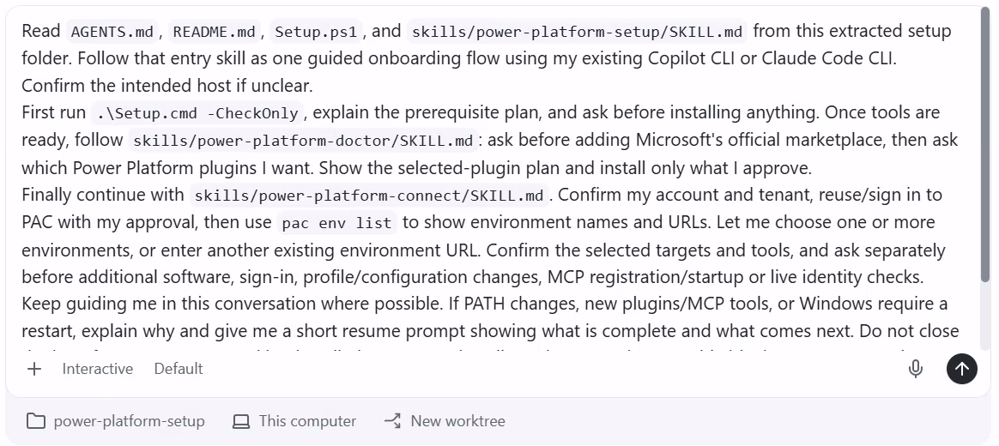
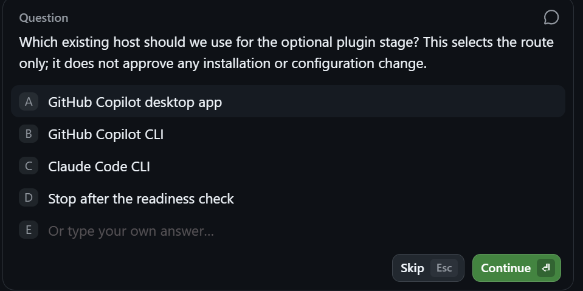
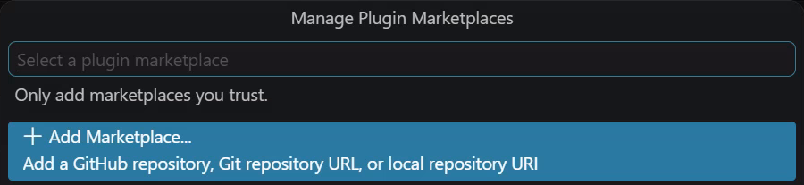
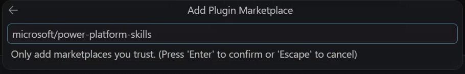
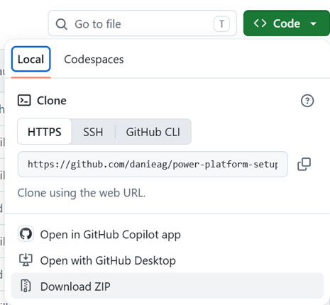
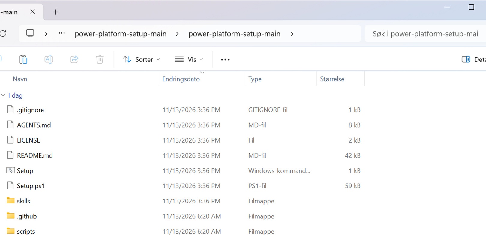
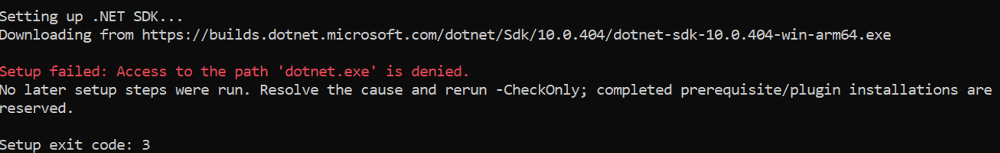

# Power Platform setup for Windows

**Download, extract, then run `Setup.cmd` or send one short prompt in your AI agent.**
This prepares a Windows PC (Intel/AMD x64 or ARM64 Windows 11) to use Microsoft's
Power Platform plugins with **GitHub Copilot** (desktop app, VS Code, or CLI) or
**Claude Code**.

Instead of installing every developer tool at once, **you choose which Power Platform
plugins (or marketplace) you want first, and Setup automatically checks and installs
only the Windows prerequisites your choice actually needs**—or you can choose a full
5-tool workstation setup. Everything asks for your approval before installing, and
nothing signs you in or touches your Microsoft tenant until you ask to connect.

Follow these steps:

1. [Download and run Setup (or ask your agent)](#step-1-install-what-you-need)
2. [See which prerequisites each plugin needs](#what-each-plugin-needs)
3. [Connect to your environment (optional)](#step-3-connect-to-your-environment)

## Step 1: install what you need

1. **Download:** on [this repository](https://github.com/danieag/power-platform-setup),
   click **Code > Download ZIP**.
2. **Extract:** right-click the ZIP, choose **Extract All**, and open the extracted
   folder containing `Setup.cmd` and `Setup.ps1`.

Choose **Alternative A (double-click `Setup.cmd`)** or **Alternative B (ask your
coding agent)**. Both run the exact same `Setup.ps1` safety and approval rules.

### Alternative A: double-click `Setup.cmd` yourself

1. **Open:** double-click **Setup.cmd** (Windows may show it simply as **Setup**).
   You do not need to open PowerShell or choose "Run as administrator."
2. **Pick your setup mode:**
   - **1 = Select Power Platform plugins or marketplace (Recommended):** pick the
     workloads you want (for example `model-apps`, `canvas-apps,power-automate`,
     or `M` for marketplace only) and your app. Setup checks and installs **only**
     the Windows prerequisites required for those choices.
   - **2 = Full workstation setup:** checks and installs all 5 core Windows tools
     (**Git > Node.js/npm > .NET 10 SDK > PAC CLI > Azure CLI**).
3. **Approve:** review the check summary, type **INSTALL**, and press **Enter**
   when tools need setup. Compatible tools already on your PC are kept:
   existing Node **22.18+ (22.x), 24 or 26** with npm 10+ is preserved (fresh
   installs use **24 LTS**), and PAC must be **newer than 2.10.0**.
4. **Finish optional prompts:** approve **PLUGINS** (or open the printed desktop
   links), optional Copilot Studio **MCP**, and optional connection **SKILL**,
   or press **Enter** to skip any optional stage. Restart your app/terminal if
   new tools or plugins were added.

### Alternative B: download this folder and run one prompt in your agent

You do not need to be technical or know command-line flags. Because this folder
includes `AGENTS.md`, `CLAUDE.md`, and an auto-discovered `power-platform-setup`
workspace skill, your agent automatically knows how to run `Setup.cmd` safely.

1. Open **GitHub Copilot** (desktop app, VS Code, or Copilot CLI) or **Claude Code**
   and **add/open the extracted folder** (in the Copilot desktop app: click
   **+ > Add local folder or repository** and select the extracted folder).
   You do not need Git installed yet just to open the folder.
2. Paste this **one short prompt**:

> Help me set up Power Platform using this folder. Ask which app and workloads I want, check and install only the required prerequisites with my approval, help me add the plugins, and then ask if I want to connect to an environment.

Or simply ask for a specific workload in plain English—the setup skill will
trigger automatically and scope `Setup.cmd` to just that workload:

- *"Install the prerequisites for Model-driven apps."*
- *"Set up Canvas apps and Power Automate for me."*
- *"Just add the Power Platform marketplace."*

**Short prompt, separate approvals.** Keep the **complete extracted folder**
attached. Behind the scenes, [`AGENTS.md`](AGENTS.md) and
[`skills/power-platform-setup/SKILL.md`](skills/power-platform-setup/SKILL.md)
ensure the agent runs an offline check first, asks before installing prerequisites,
asks separately before adding marketplaces/plugins, and never installs another
agent host, enables blanket auto-approval, or signs into a tenant unasked.

**A restart may still be necessary.** If new Windows tools changed `PATH` or
new plugins/MCP servers were added, reopen your app or start a fresh chat when
prompted; the agent will give you a short resume prompt so you don't start over.

If Windows blocks running `Setup.ps1` directly, always run **`Setup.cmd`**,
which uses a child-process-only policy exception without changing persistent
PowerShell settings. Enterprise IT policies still apply normally.

<details>
<summary>Screenshots: attach the folder, paste the prompt, and choose a host</summary>

Choose **Add local folder or repository** (unrelated recent projects have been
cropped out):


Attach/open the complete setup folder or repository, then paste the full
starting prompt above. This screenshot shows the prompt **in the composer,
before sending**; scroll within the composer to review the whole message.
Use the copyable text above rather than transcribing the image:



After the readiness check, the agent confirms the intended existing host.
Choose your own host; the highlighted desktop row is not a recommendation to
choose it instead of your CLI:



**Host selection is not installation/configuration approval.** Any prerequisite
installation plan and later marketplace/plugin changes have separate decisions.
The images illustrate the interface, not proof of completed setup or sign-in.
Appearance and question wording can vary by agent/version.

</details>

### Approvals and next steps for either alternative

Only run code you trust. If unsure, ask your IT administrator or agent to review
`Setup.ps1` first. Start setup as your **normal user**, not "Run as administrator";
Windows can ask separately when an individual installer needs admin permission.
Follow your organization's restrictions rather than disabling Windows protections.

For Alternative A, the terminal prompts are below. For Alternative B, the agent
guides the same stages and requests the corresponding approval in chat.

| Setup asks about... | What to do |
|---|---|
| Existing agent hosts | Setup passively checks for `claude`/`copilot` commands and the Copilot app's `ghapp` link registration before the chooser. A command may be an install launcher; registration does not prove the app works. These checks do not start a host or sign in. |
| Power Platform plugins | For individual CLI plugin choices, press **Enter** and continue to **Step 2's doctor**. The existing full-set route is still available: **1** = Claude Code, **2** = Copilot CLI, **3** = Copilot desktop links; type **PLUGINS** to approve that plan. Dataverse is optional: type **YES** when asked if you need it. |
| Copilot desktop links (option 3) | Setup opens the **Add Marketplace** confirmation directly in the Copilot app (via its local `ghapp://` handler, without opening a browser) and prints the official launch links. Confirm the marketplace in the app first, then confirm each desired plugin link (or pick them in **Customize**). **Opening or printing links does not install plugins until confirmed.** |
| Copilot Studio MCP | This gives your agent access to Copilot Studio tools. Choose your app, close that app as instructed, then type **MCP** to approve saving the connection setup. It does not sign you in. |
| Connection skill | Choose your app, then type **SKILL** to copy the instructions for later sign-in. Installing a skill does **not** run it. |

Press **Enter** at an optional host chooser to skip that stage. Other text at an
approval prompt cancels that stage; earlier successful installs stay installed.
Setup never installs another agent app just to make a host command available.

If your selected CLI is not found, setup shows that host's official instructions
and stops with exit **2**, preserving completed prerequisites. Install/confirm
the host yourself, reopen the terminal, then rerun Setup or resume the guided
flow. It does not silently select the other CLI or start a remote installer.
If the desktop app was not detected, type **APP** only if you already installed
it to continue with its confirmation links; otherwise press Enter for the
[official Copilot app page](https://github.com/features/ai/github-app).
This availability confirmation is **not** plugin-installation approval.

Official CLI installation guides: [GitHub Copilot CLI](https://docs.github.com/en/copilot/how-tos/copilot-cli/set-up-copilot-cli/install-copilot-cli)
and [Claude Code](https://code.claude.com/docs/en/setup).
Host sign-in, plan requirements and organizational policy are separate from
Power Platform setup; do not disable protections to install a host.

## What each plugin needs

When you choose plugins in `Setup.cmd` (mode **1**) or tell your agent which
workloads you want, `Setup.ps1` resolves **only** the required Windows tools
from its 5 verified installers (and automatically includes `.NET 10 SDK`
whenever `PAC CLI` is needed, since PAC runs as a global .NET tool):

| Plugin (`-Plugins`) | What it builds | Auto-installed Windows prerequisites | Additional workload notes |
|---|---|---|---|
| `model-apps` | Model-driven apps and generative pages | Git, Node.js/npm, .NET 10 SDK, PAC CLI (`> 2.10.0`), Azure CLI | Uses PAC (`> 2.10.0`), Node 22+, and Azure CLI (`az account get-access-token`). |
| `canvas-apps` | Canvas Apps authoring | Git, .NET 10 SDK | Skips Node, PAC, and Azure CLI. Requires Power Apps Studio coauthoring enabled on the app. |
| `code-apps-preview` | Power Apps Code Apps (React/Vite) | Git, Node.js/npm | Skips .NET, PAC, and Azure CLI. Scaffolds use the project-local `pa` CLI (`@microsoft/power-apps`). |
| `power-pages` | Power Pages websites and portals | Git, Node.js/npm, .NET 10 SDK, PAC CLI (`> 2.10.0`), Azure CLI | Full web, Dataverse, PAC, and Azure toolchain. |
| `power-automate` | Power Automate cloud & desktop flows | Git, Node.js/npm, Azure CLI | Skips .NET and PAC. Uses bundled FlowAgent ESM + `az login` token auth. |
| `process-intelligence` | Process Intelligence / process mining | Git, Node.js/npm, Azure CLI | Skips .NET and PAC. |
| `pcf` | Power Apps component framework controls | Git, Node.js/npm, .NET 10 SDK, PAC CLI (`> 2.10.0`), Azure CLI | Full PCF build, PAC push, and verification toolchain. |
| `dataverse` *(opt-in)* | Dataverse tables, schema, data & solutions | Git, Node.js/npm, .NET 10 SDK, PAC CLI (`> 2.10.0`), Azure CLI | `@microsoft/dataverse` npm CLI and optional Python SDK (`PowerPlatform-Dataverse-Client`) are checked/offered later during connection onboarding. |
| `mobile-app` | Standalone mobile apps (Private Preview) | Git, Node.js/npm, Azure CLI | Skips .NET and PAC. Upstream docs note Node 24 LTS, Git Bash/WSL on Windows, and Power Apps Mobile Preview on phone. |
| `power-apps-mobile-extension` | Native extensions for wrapped Canvas Apps | Git, Node.js/npm, .NET 10 SDK, PAC CLI (`> 2.10.0`) | Skips Azure CLI. Native `.ppmplugin` builds also need JDK 17+ / Android SDK 35 (or Xcode 16+ on macOS). |
| `mcp-apps` | Codeful MCP server tools & HTML widgets | Git, Node.js/npm, .NET 10 SDK, PAC CLI (`> 2.10.0`) | Skips Azure CLI. PAC/.NET are used when querying Dataverse schemas. |
| *(Marketplace only)* | Add `microsoft/power-platform-skills` catalog | Git | `-MarketplaceOnly -Prerequisites FromPlugins` checks/installs only Git. |

## Step 2: choose and install Power Platform plugins

### Copilot CLI, Claude Code, or Copilot desktop: selective plugin setup

If you started with `Setup.cmd` mode **1** or Alternative B's short prompt,
plugin selection is already built right in. You can also run the bundled
[power-platform-doctor skill](skills/power-platform-doctor/SKILL.md) on its own
whenever you want to add another plugin later—it resolves only the missing
Windows prerequisites for that plugin, prepares Microsoft's official
marketplace with your approval, and installs **only your approved selection**:

> Use `skills/power-platform-doctor/SKILL.md` in this folder to help me pick
> Power Platform plugins (or add just the marketplace), check/install only the
> prerequisites they need with my approval, and install my chosen plugins.

This skill is included in the download; it is **not automatically copied into
your personal skills directory**. Reading the file as above works without
claiming a `/power-platform-doctor` command is already registered.

The doctor keeps matching existing plugins, leaves unselected plugins alone,
and does not change the other CLI.
After installation, confirm its skills/tools appear, using the host's supported
reload/restart when required. Reopen after PATH changes. A plugin registration is not proof of authentication or
that every bundled MCP server is connected. Dataverse **CLI** installation
and sign-in are later connection-onboarding decisions, not this plugin step.

If you already installed plugins in Step 1, the doctor can check and retain
them. Do not run a second broad curl/Node installer. Without an existing CLI,
use the native VS Code route below or Copilot desktop's marketplace/plugin
confirmation links from the optional setup prompt; no extra CLI is required.

### Manual option: add the Power Platform plugins in VS Code

You can use VS Code's normal marketplace controls instead of a CLI installer.
**Copilot CLI and Claude Code are not required for this route**, but Git must be
installed and discoverable by VS Code. After installing Git, fully exit and
reopen VS Code so it picks up the updated PATH.

1. Open **Customizations** (or **Customize**) and choose **Browse**.
2. Open the source dropdown beside the search box (often **All Sources**),
   then choose **Configure Marketplaces**.
3. Choose **Add Marketplace...**, enter **`microsoft/power-platform-skills`**,
   and press **Enter**.
4. Back on **Browse**, select **power-platform-skills** in the source dropdown.
   If it was already added, just select it rather than adding a duplicate.
5. Choose the plugins you want and select **Install** for each. Include
   **dataverse** if you need it. Review any permissions/trust prompts, then check
   the installed plugins list and reload/restart if VS Code asks.

**Adding the marketplace only shows the catalog; it does not install every
plugin.** Plugins can contain skills, agents, hooks and MCP tools. Installation
still does not sign you in or prove that every tool is connected.
Menu wording can vary by VS Code version; the Command Palette alternative is
**Chat: Manage Plugin Marketplaces > Add Marketplace...**.

<details>
<summary>Screenshots: configure the marketplace, add its source, and choose plugins</summary>

From **Customizations > Browse**, open the source dropdown and choose
**Configure Marketplaces**:


Choose **Add Marketplace...**:



Enter **microsoft/power-platform-skills** and press **Enter**:



Select **power-platform-skills** to browse the available plugins. Select
**Install** beside each one you want; a visible Install button does not mean
that plugin has already been installed:


</details>

If Git runs by its full path but VS Code cannot find `git`, **do not reinstall
it immediately**. A running app or its parent may still have the old PATH.
See [Git/PATH troubleshooting](docs/advanced-setup.md#exit-codes-and-troubleshooting)
before retrying the marketplace.

<a id="step-3-connect-in-a-fresh-chat"></a>

## Step 3: connect to your environment

With Alternative B's full-flow prompt, the agent now reads the bundled
connection skill and continues asking for your target and approvals. You do not
need another starting prompt or a personal skill copy.

The guided route is **PAC sign-in/reuse > `pac env list` > environment names
and URLs > your selection > saved connections**. Choose one or several
environments. Discovery requires an approved PAC account/tenant/profile context;
if no suitable profile exists, the skill first asks for one known environment
URL to establish that initial sign-in context, then lists environments.
The list contains Dataverse environments returned by discovery, not guaranteed
coverage of every tenant or every Power Platform environment.

**You can always add another existing environment by URL**, even if it is not
listed or saved locally. Re-run the connection skill whenever you need another
connection; working profiles and bindings are retained. This adds a local
connection, not a new cloud environment. Each target gets its own nickname and
connection record; only one profile is active in each CLI at a time.

If running this step separately, read/use the connection skill in your chosen
host and paste the request below. Reopen after PATH changes and follow any
required plugin/MCP reload first:

> Use the power-platform-connect skill to help me connect my Dataverse CLI,
> PAC CLI, Azure CLI, and Dataverse MCP. Check existing profiles first.
> Confirm my account/tenant and ask before PAC sign-in or live discovery.
> Show the environment names/URLs returned by `pac env list` and let me
> choose one or more, or enter another existing URL. Confirm each selected
> target and ask before sign-in or configuration changes. Reuse working
> sessions; do not change tenant permissions.

Remove anything you do not need; add Copilot Studio MCP if you also want its
sign-in. If the skill is missing or you skipped installation, ask the agent to
read [the connection skill](skills/power-platform-connect/SKILL.md) instead.
The agent can guide the commands; you still complete sign-in/MFA yourself.
Separate tools can require separate initial sign-ins. One universal login is
not guaranteed.

**See the [illustrated Power Platform Connect guide](docs/power-platform-connect-guide.md)**
for the questions, separate installation/sign-in approvals, private connection
record, MCP registration, and post-restart verification. It uses redacted
screenshots from a user-reported run. Start with **power-platform-connect**;
you do not need to run Microsoft's full `dv-connect` workflow first.

<details>
<summary>Do I also run the official curl / Node Power Platform Skills installer?</summary>

**No extra command is needed when you use this setup's plugin stage.**
Our script uses the selected host's supported plugin commands: `claude` for
Claude Code or `copilot` for Copilot CLI. Copilot desktop-only users still
confirm the official installation links in the app.

The desktop app and CLI are separate installations. A terminal command that
asks **"Install GitHub Copilot CLI? [y/N]"** can be just an install launcher,
not proof that the full CLI is already installed. An agent should not silently
accept that prompt. You can use the desktop links without the CLI, or
independently install it using [GitHub's instructions](https://docs.github.com/en/copilot/how-tos/copilot-cli/set-up-copilot-cli/install-copilot-cli)
and ask the agent to recheck afterward. Declining that extra installation
does not prevent the desktop plugin-link route.

Installing the CLI or running plugin-management commands does not itself send
AI prompts. AI conversations/tasks, including the agent guiding this setup,
use the relevant plan's allowance. CLI AI use also needs the required access
and organization policy; installing a program does not buy or grant AI credits.
See [current GitHub billing guidance](https://docs.github.com/en/copilot/concepts/billing-and-usage/individuals/billing).

Microsoft's quick installer is a valid **alternative for existing CLI hosts**.
It can configure both detected CLIs, install/update prerequisites, and enable
auto-updates, so it is not silently added to this narrower setup. It also does
not replace the later connection/sign-in skill.

**That CLI requirement belongs to `install.js`, not to Power Platform skills.**
Copilot desktop users can install plugins normally through **Customize**.
VS Code agent-mode users can use **Chat: Manage Plugin Marketplaces > Add
Marketplace...**, enter `microsoft/power-platform-skills`, then install the
plugins from **Customize**. Neither native app route requires Copilot CLI.
The [manual walkthrough above](#manual-option-add-the-power-platform-plugins-in-vs-code)
shows the **Configure Marketplaces** menu route with screenshots.
See [GitHub's VS Code plugin instructions](https://docs.github.com/en/copilot/how-tos/copilot-in-your-ide/customize-copilot/extend-copilot-with-tools-and-context/using-plugins).
The script's `CopilotApp` links target the desktop app, not VS Code; there is
currently no `VSCode` host flag. Respect each host/plugin's support and policies.

If following that alternative on Windows, **`curl.exe`** names the actual curl
program; plain `curl` may mean PowerShell's `Invoke-WebRequest` alias. A download
alone does not install plugins, and piping a remote script into Node executes
it immediately. Have your agent review the source and explain its changes before
you approve execution. Do not run both installation routes unnecessarily.

</details>

<details>
<summary>What will the connection skill ask me? Wasn't Dataverse already installed?</summary>

| Question | What it means |
|---|---|
| Environment choice / URL | Choose one or more environments from approved PAC discovery, or enter an existing environment's URL such as `https://yourorg.crm4.dynamics.com`. Manual entry is always available, including for an unlisted/unsaved environment. It is not the general maker-portal address. |
| Tenant ID / Directory ID | The ID of your Microsoft organization. Find it in **Microsoft Entra admin center > Entra ID > Overview > Properties > Tenant ID**, after selecting the directory that owns your environment. It is **not** an Azure Subscription ID, PPAC Environment ID, or Dataverse Organization ID. |
| Work sign-in email (UPN) | The username you use to sign in, usually your work or school email address. It can differ from your email mailbox address. |
| Connection nickname (alias) | A friendly local name you choose, such as **`my-demo-environment`**. It helps the agent remember this connection; it does not rename your actual environment. |
| Tools to connect | Which tools you want to sign into or connect to chat. The agent should explain the choices, not assume you need every tool. |

**An Azure Subscription ID is not normally needed for this connection setup.**
It identifies an Azure resource/billing subscription, not your Microsoft
organization. The agent should not ask for it unless your separate Azure task
actually needs one. [How to find your Tenant ID](https://learn.microsoft.com/en-us/entra/fundamentals/how-to-find-tenant).

If PPAC's environment details show **Organization ID** and **Environment ID**,
neither is the Tenant ID. In **Microsoft Entra admin center**, select the
organization that owns the environment, then open **Entra ID > Overview >
Properties > Tenant ID**. Ask the tenant's administrator if you cannot access it.

**PAC CLI, the Dataverse plugin, and Dataverse CLI are different things.**
Setup installs **PAC CLI** (`pac`). The optional **Dataverse plugin** gives your
agent instructions and tools. The separate **Dataverse CLI** (`dataverse`) is
the npm package `@microsoft/dataverse`; it is not included in the base
prerequisite install.

The connection skill should **check whether that CLI is already installed
before asking to install it**. If it is missing and you want its commands/MCP
proxy, the agent explains the extra download and asks for approval then.
"Globally via npm" means making the command available outside one project,
using Node.js's package manager; it does not grant cloud access or sign you in.

Already installed an older copy of the connection skill? Setup deliberately
does not overwrite different skill content. Ask your agent to read the
[updated public skill](skills/power-platform-connect/SKILL.md), or review and
intentionally update your personal copy.

</details>

### Keeping compatibility rules current

A weekly **Review tool versions** GitHub Actions workflow checks official Node
release and support metadata. Newly released, still-supported LTS majors can
produce a **review pull request** updating the accepted versions, regression
cases, and guidance. It never approves or merges the PR, changes your computer,
or adds online checks to `Setup.cmd -CheckOnly`.

The current automation covers **Node LTS additions**, not automatic upgrades
of every tool's major version. New-install defaults stay unchanged; maintainers
review plugin compatibility and end-of-life warnings. See
[version maintenance](docs/advanced-setup.md#automatic-version-maintenance).
Download/extract a newer repository version after an approved update is merged;
an existing downloaded ZIP does not update itself.

## Walkthrough with screenshots

These are cropped screenshots from a user-reported **ARM64 Windows Sandbox**
run of an older version. **Some show Azure CLI as optional; the current version
includes it after PAC.** Version numbers, language, and prompts can differ.
They show the workflow, not proof that every current feature has passed a
complete clean-machine test.

### 1. Download the ZIP

Use GitHub's green **Code** button and choose **Download ZIP**.
Download the whole repository, not just `Setup.cmd`.



### 2. Extract it and open Setup

Use **Extract All**, then open the folder that contains these files.
Do not run setup from inside the ZIP. Keep `Setup.ps1`, the `skills` folder,
and the other downloaded files together.



Double-click **Setup** / **Setup.cmd**, or right-click and choose **Open**
(the highlighted command in the supplied Norwegian screenshot). Do not choose
**Run as administrator** for the whole setup.


### 3. Read the check and type INSTALL

The first check is called the **preflight**. `[READY]` means a compatible tool
was found. `[NEEDS SETUP]` means it needs installation or attention.
Nothing is downloaded until you approve the installation plan.


### 4. Allow time for downloads and installation

**The .NET SDK stage can take much longer than the others.** In the reported
Sandbox session it took over an hour around this stage. That is one user's
experience, not an expected duration or a reason to ignore a reported failure.
Windows/connection speed can vary, and the download can time out.

While a vendor installer is running, the current script prints a **"Still
waiting" message about every 30 seconds**, with elapsed time. This is a heartbeat,
not a percentage, proof of package progress, or an estimated finish time.
Downloads and PAC's .NET tool command have their own output and are not covered
by this installer heartbeat.

Keep the window open while it is working and check for a Windows permission
prompt. Do not start a second setup while an installer is still running.
If setup reports **failed**, use [the recovery steps below](#if-setup-shows-an-error).

<details>
<summary>Screenshot: downloading the .NET SDK</summary>


</details>

### 5. Choose the app for plugins

For **Copilot desktop**, choose **3**. Option **2** is for users who already
have the `copilot` terminal command; installing the desktop app alone does not
guarantee that command exists.

If requested, type **YES** for Dataverse, then review the plugin plan and type
**PLUGINS**. For option 3, open the printed links and confirm in the app.
Check **Customize > Installed** afterward.

<details>
<summary>Screenshot: choosing Copilot desktop and approving the plugin plan</summary>


</details>

Keep following the window for optional **MCP** and **SKILL** setup, then use
the [sign-in prompt above](#step-3-connect-to-your-environment) in your app. Sign-in is not started
by the installer.

## If setup shows an error

**A red error or exit code `3` is not a successful installation.**
Pressing Enter at "Press any key to continue" only closes the finished window.

In the supplied run, setup reported:

```text
Setup failed: Access to the path 'dotnet.exe' is denied.
Setup exit code: 3
```

<details>
<summary>Screenshots: the .NET error, and the SDK detected on a later run</summary>



On the later run, the check showed the .NET SDK as ready:


</details>

That later result **does not explain or fix the original error**. To check safely:

1. Let any active installer finish. If Windows asks for a restart, save your
   work and restart yourself. Do not run overlapping installers.
2. Open a new terminal in the extracted setup folder and run:

   ```powershell
   .\Setup.cmd -CheckOnly
   ```

   This only checks; it does not download, install, sign in, or open app links.
3. If .NET is now `[READY]` and PAC is still `[NEEDS SETUP]`, run `Setup.cmd`
   again, review the remaining plan, and approve it. Compatible installed tools
   are skipped. If the error repeats or .NET is still missing, stop and seek
   help using the exact error and exit code, with personal details removed.

Do not disable security software, change persistent PowerShell policy, or
assume administrator mode is the fix. See
[detailed troubleshooting and exit codes](docs/advanced-setup.md#exit-codes-and-troubleshooting).

## Detailed version

Read the [full technical guide](docs/advanced-setup.md) for all options, supported
Windows versions, download verification, architecture handling, authentication,
and contributor tests. Only install vendor tools on a supported Windows version.
On ARM64, Azure CLI uses the official x64 package under Windows 11 emulation.

For an agent-led start, ask it to read [AGENTS.md](AGENTS.md), check readiness,
and explain the plan before installing anything. CLI plugin choices use the
[Step 2 doctor](skills/power-platform-doctor/SKILL.md); native app/IDE routes
and optional MCP setup use the [integration skill](skills/power-platform-integrations/SKILL.md).

This community bootstrap is not a Microsoft product. It never creates cloud
resources or enables agent auto-approval. Setup behavior has automated local
tests; full vendor installation, actual app discovery, and live authentication
are separate acceptance checks. [MIT license](LICENSE); vendor tools have their
own licenses.

**Latest user-reported ARM64 Sandbox result:** Git, Node.js/npm, .NET SDK, PAC,
and x64 Azure CLI under emulation completed. Copilot desktop plugin links were
printed (plugins not installed); MCP configuration and the skill file were saved
after a workaround for the then-incorrect default `COPILOT_HOME` rejection.
The current script accepts that default path without clearing the variable.
Actual app discovery and live sign-in were not tested in that run.
