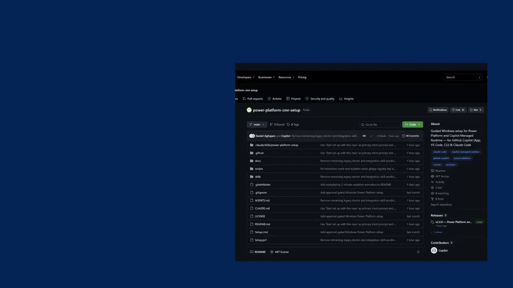
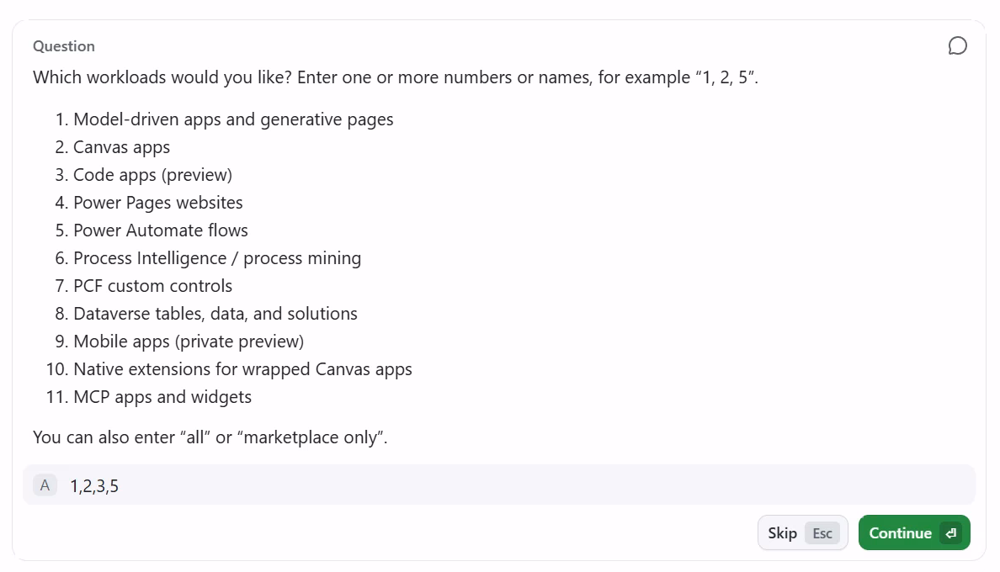
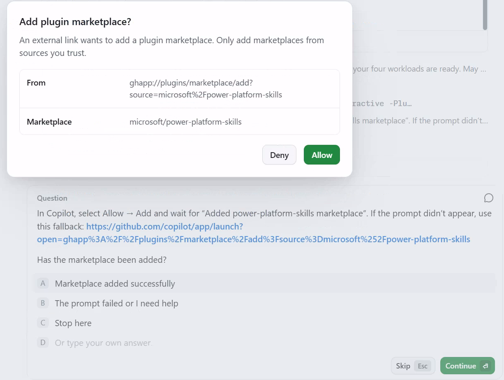
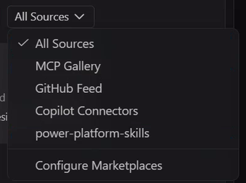

# Power Platform and Copilot Managed Runtime setup for Windows

Set up a Windows PC (Intel/AMD x64 or ARM64 Windows 11) for Microsoft's
[Power Platform plugins](https://github.com/microsoft/power-platform-skills)
and/or [Copilot Managed Runtime](https://github.com/microsoft/Copilot-Managed-Runtime)
(Managed Apps) in **GitHub Copilot** (desktop app, VS Code, or CLI) or **Claude Code**.

- **Pick your track & install only what you need:** choose **Power Platform**, **Copilot Managed Runtime**, or **Both**, and `Setup.cmd` checks and installs **only** the Windows prerequisites your selections require (or choose full 5-tool Power Platform workstation setup).
- **Approval-gated & safe:** checks are offline and read-only; every install, plugin, MCP server, and sign-in step asks before changing anything.
- **Persistent environment routing:** connect Power Platform environments once with `power-platform-connect`, and `power-platform-router` lets future projects confirm **Environment X and Solution Y** without re-asking for URLs, Tenant IDs, or emails.



---

## Quick start

1. Click **Code > Download ZIP** on [this repository](https://github.com/danieag/power-platform-cmr-setup) *(or download the latest packaged `.zip` from [Releases](https://github.com/danieag/power-platform-cmr-setup/releases) — v1.0.0 is also archived there if you ever need the Power Platform-only baseline)*.
2. Right-click the downloaded ZIP, choose **Extract All**, and open the extracted folder.

Choose **Option A (use your AI agent)** or **Option B (double-click `Setup.cmd`)**—both run the same `Setup.ps1` script.

<a id="alternative-b-download-this-folder-and-run-one-prompt-in-your-agent"></a>

### Option A: ask your AI agent (easiest)

1. Open **GitHub Copilot** (desktop app, VS Code, or CLI) or **Claude Code** and **attach/open the extracted folder** (in the Copilot desktop app: **+ > Add local folder or repository**). You do not need Git installed first.
2. Type one short prompt:

> Help me get set up

*(Even `"Start setup"` or `"Set up"` works—opening this folder automatically loads the setup guide, so your agent knows to ask what you want to build, check/install only the missing tools with your approval, add your plugins, and guide you on connecting.)*

Or name what you want directly in plain English:

- *"Set up Copilot Managed Runtime."*
- *"Install the prerequisites for Model-driven apps."*
- *"Set up Canvas apps, Power Automate, and Copilot Managed Runtime."*
- *"Just add the Power Platform marketplace."*

**Full step-by-step screenshots:** see the **[Visual Walkthrough & Media Bank](docs/media-bank.md)** *(screenshots are viewable on GitHub and excluded from `.zip` downloads so the download stays tiny)*.

<details>
<summary>Preview screenshots: attach folder, select multiple workloads, and confirm marketplace</summary>

Attach the setup folder or repository and send the short prompt:


Pick one or multiple workloads at once (for example `1,2,3,5`):



On the GitHub Copilot desktop app, Setup opens the native `Add plugin marketplace?` dialog directly inside the app (`Allow` -> `Add`), waits for your confirmation, and then opens each selected plugin's install prompt one by one before offering environment connection:



</details>

### Option B: double-click `Setup.cmd` yourself

1. Double-click **`Setup.cmd`** (shown in File Explorer as **Setup**). Start as your normal Windows user—Windows will prompt separately if an installer needs administrator permission.
2. Choose what you want to set up:
   - **`1` = Power Platform plugins or marketplace:** pick one or more numbers/IDs (e.g. `2, 3, 7`), `M` (marketplace only), or `A` (all 11), then pick your app. Setup installs **only** the prerequisites those plugins need.
   - **`2` = Copilot Managed Runtime (Managed Apps):** installs **Git (with Credential Manager)**, **Node.js 24.11+**, and **`@microsoft/cmr-cli` (`ms`)** (skipping .NET, PAC, and Azure CLI), then adds the `microsoft/Copilot-Managed-Runtime` marketplace and `copilot-managed-runtime` plugin.
   - **`3` = Both (Power Platform + Copilot Managed Runtime):** pick your Power Platform workloads and combine them with `copilot-managed-runtime` in one pass.
   - **`4` = Full Power Platform workstation setup:** checks and installs all 5 core Power Platform tools (**Git > Node.js/npm > .NET 10 SDK > PAC CLI > Azure CLI**).
3. Review the preflight summary and type **`INSTALL`** to approve any missing tools. For Power Platform workloads, existing Node **22.18+ (22.x), 24 or 26** with npm 10+ is preserved (fresh installs use **24 LTS**); when **Copilot Managed Runtime** is included, Node must be **24.11.0+** with Git Credential Manager. PAC CLI must be **newer than 2.10.0**.
4. Follow or press **Enter** to skip the optional stages:
   - **`PLUGINS` / `MARKETPLACE`:** adds the official marketplace(s) and your chosen plugins in Claude Code CLI, Copilot CLI, or the Copilot desktop app.
   - **`MCP`:** registers `@microsoft/copilot-studio-mcp@latest` (close the target app first; does not sign in).
   - **`SKILL`:** installs `power-platform-connect` and `power-platform-router` into your personal skills directory (`~/.copilot/skills/` or `~/.claude/skills/`).
5. Reopen your app and terminals if new Windows tools changed `PATH`.

---

## What each workload needs

When you choose one or several workloads, `Setup.ps1` computes the union of their required Windows tools automatically (including `.NET 10 SDK` whenever `PAC CLI` is needed, and Node **24.11.0+** + Git Credential Manager whenever **Copilot Managed Runtime** is included):

### Copilot Managed Runtime (`microsoft/Copilot-Managed-Runtime`)

| Plugin (`-Plugins`) | What it builds | Auto-installed Windows prerequisites | Workload notes |
|---|---|---|---|
| `copilot-managed-runtime` | Microsoft 365 Managed Apps (`ms` CLI, React/Vite) | Git (with GCM), Node.js **24.11.0+** / npm, `@microsoft/cmr-cli` (`ms`) | Skips .NET, PAC, and Azure CLI. Signs in separately via `ms auth login` to its personal developer environment; distinct from Power Apps Code Apps (`pa`). |

### Power Platform Skills (`microsoft/power-platform-skills`)

| Plugin (`-Plugins`) | What it builds | Auto-installed Windows prerequisites | Workload notes |
|---|---|---|---|
| `model-apps` | Model-driven apps & generative pages | Git, Node.js/npm, .NET 10 SDK, PAC CLI (`> 2.10.0`), Azure CLI | Uses PAC, Node 22+, and Azure CLI (`az account get-access-token`). |
| `canvas-apps` | Canvas Apps authoring | Git, .NET 10 SDK | Skips Node, PAC, and Azure CLI. Enable Studio coauthoring on the app. |
| `code-apps-preview` | Power Apps Code Apps (React/Vite) | Git, Node.js/npm | Skips .NET, PAC, and Azure CLI. Uses project-local `pa` CLI during scaffold. |
| `power-pages` | Power Pages websites & portals | Git, Node.js/npm, .NET 10 SDK, PAC CLI (`> 2.10.0`), Azure CLI | Full web, Dataverse, PAC, and Azure toolchain. |
| `power-automate` | Power Automate cloud & desktop flows | Git, Node.js/npm, Azure CLI | Skips .NET and PAC. Uses bundled FlowAgent + `az login`. |
| `process-intelligence` | Process Intelligence / process mining | Git, Node.js/npm, Azure CLI | Skips .NET and PAC. |
| `pcf` | Power Apps component framework controls | Git, Node.js/npm, .NET 10 SDK, PAC CLI (`> 2.10.0`), Azure CLI | Full PCF build, PAC push, and verification toolchain. |
| `dataverse` *(opt-in)* | Dataverse tables, schema, data & solutions | Git, Node.js/npm, .NET 10 SDK, PAC CLI (`> 2.10.0`), Azure CLI | `@microsoft/dataverse` npm CLI and optional Python SDK are offered later during connection setup. |
| `mobile-app` | Standalone mobile apps (Private Preview) | Git, Node.js/npm, Azure CLI | Skips .NET and PAC. Upstream docs note Node 24 LTS, Git Bash/WSL, and Power Apps Mobile Preview. |
| `power-apps-mobile-extension` | Native extensions for wrapped Canvas Apps | Git, Node.js/npm, .NET 10 SDK, PAC CLI (`> 2.10.0`) | Skips Azure CLI. Native `.ppmplugin` builds also need JDK 17+ / Android SDK 35 (or macOS Xcode 16+). |
| `mcp-apps` | Codeful MCP server tools & HTML widgets | Git, Node.js/npm, .NET 10 SDK, PAC CLI (`> 2.10.0`) | Skips Azure CLI. PAC/.NET are used when querying Dataverse schemas. |
| *(Marketplace only)* | Add `power-platform-skills` and/or `Copilot-Managed-Runtime` | Git | `-MarketplaceOnly -Marketplace <PowerPlatform\|CopilotManagedRuntime\|Both> -Prerequisites FromPlugins` checks/installs only Git. |

---

## Manual option: add plugins in VS Code

VS Code Copilot users do not need Copilot CLI or Claude Code—only Git on `PATH` (fully exit and reopen VS Code if Git was just installed):

1. Open **Customizations** (or **Customize**) > **Browse**.
2. Open the source dropdown (**All Sources**) > **Configure Marketplaces**.
3. Select **Add Marketplace...**, enter **`microsoft/power-platform-skills`** and/or **`microsoft/Copilot-Managed-Runtime`**, and press **Enter**.
4. Select **power-platform-skills** or **Copilot-Managed-Runtime** in the source dropdown.
5. Click **Install** beside each plugin you want (Command Palette alternative: **Chat: Manage Plugin Marketplaces > Add Marketplace...**).

<details>
<summary>VS Code marketplace screenshots</summary>




</details>

---

## Connect to your environment & reuse across projects

Once your plugins are installed, `power-platform-connect` guides persistent sign-in and saves a private, token-free binding record at `%LOCALAPPDATA%\PowerPlatformSetup\connections\<alias>.json`:

- **Checks what is installed:** connects **PAC CLI** (`pac env list` environment picker or manual URL) and **Azure CLI** (tenant-isolated `AZURE_CONFIG_DIR`) when installed and used by your plugins, and checks whether the **`dataverse` plugin** is installed before offering **Dataverse CLI** (`@microsoft/dataverse`) and **Dataverse MCP** (skipping them cleanly if `dataverse` is not installed).
- **Maps per-environment MCP servers:** records which Dataverse MCP, Power Automate FlowAgent MCP, and Copilot Studio MCP server belongs to each saved environment.
- **Automatic routing in future projects (`power-platform-router`):** when installed into your personal skills folder (`SKILL` stage or `-ConnectionSkillHost`), future chats, Projects (like Code Apps or Model Apps), and child sessions read your saved `<alias>.json` records automatically—asking you to confirm **Environment X and Solution Y** instead of re-asking for Environment URLs, Environment IDs, Tenant IDs, or sign-in emails.

**See Chapters 4–6 of the [Visual Walkthrough & Media Bank](docs/media-bank.md)** for full screenshots of PAC/Dataverse/Azure connection setup, FlowAgent & Copilot Studio MCP linking, and 6-tool router verification.

---

## Included skills

| Skill | Scope | Purpose |
|---|---|---|
| [`skills/power-platform-setup`](skills/power-platform-setup/SKILL.md) | Workspace (auto-discovered in this folder) | Guides first-time Windows prerequisite checks/installs, marketplace & plugin selection, optional Copilot Studio MCP registration, and installing the two personal skills below. |
| [`skills/power-platform-connect`](skills/power-platform-connect/SKILL.md) | Personal (`~/.copilot/skills/` or `~/.claude/skills/`) | Discovers/connects Power Platform environments across PAC, Azure CLI, Dataverse CLI, and MCP servers, saving token-free `<alias>.json` binding records. |
| [`skills/power-platform-router`](skills/power-platform-router/SKILL.md) | Personal (`~/.copilot/skills/` or `~/.claude/skills/`) | Loads before/alongside Power Platform build skills (`create-code-app`, `model-apps`, `power-automate`, `dataverse`, etc.) to reuse saved environments, confirm **Environment X and Solution Y**, and route per-environment MCP servers. |

---

## Troubleshooting & technical reference

Run a read-only, offline check at any time without changing your PC:

```powershell
.\Setup.cmd -CheckOnly
```

- **Exit codes:** `0` = ready/completed, `1` = missing/unsupported prerequisites in `-CheckOnly`, `2` = cancelled or invalid options / missing CLI handoff, `3` = error (re-run `-CheckOnly` after any active installer finishes), `4` = Copilot desktop app confirmation pending, `3010` = Windows restart required.
- **Restarting the GitHub Copilot desktop app & enabling skills:** closing the window (`X`) can leave background processes running. If newly installed `PATH` tools, MCP servers, or personal skills (`power-platform-connect`, `power-platform-router`) don't appear, open **Windows Task Manager** (`Ctrl+Shift+Esc`), click **End task** on **GitHub Copilot**, reopen the app, and check **Customize > Installed** (under **Skills**) to ensure the skill toggles are switched **on**.
- **`"hook errored"` when saving `mcp-config.json`:** some plugins (such as `model-apps@power-platform-skills`) attach a pre-tool-use file-write hook that can error on Windows when writing `%USERPROFILE%\.copilot\mcp-config.json`. Temporarily toggle that plugin **off** in **Customize > Installed**, retry saving `mcp-config.json`, and toggle it back **on**.
- **Recovering from a transient installer lock (`exit code: 3`):** wait for any active background installer or Windows restart to finish, run `.\Setup.cmd -CheckOnly` to see what already completed, and rerun `Setup.cmd` (compatible installed tools are skipped automatically).
- **[Detailed Technical Guide](docs/advanced-setup.md):** all CLI flags, SHA256/SHA512 & Authenticode verification, ARM64 emulation details, weekly Node LTS review workflow, and contributor tests (`.\scripts\Test-Setup.ps1`).
- **[Visual Walkthrough & Media Bank](docs/media-bank.md):** complete, descriptively named screenshot library of the end-to-end onboarding, connection, MCP linking, and router workflow (kept out of `.zip` downloads so the download stays lightweight).
- **License:** [MIT](LICENSE) (vendor tools have their own licenses; community bootstrap, not an official Microsoft product).
