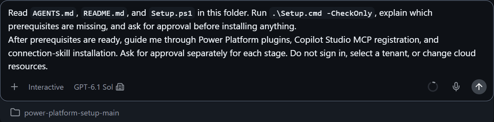
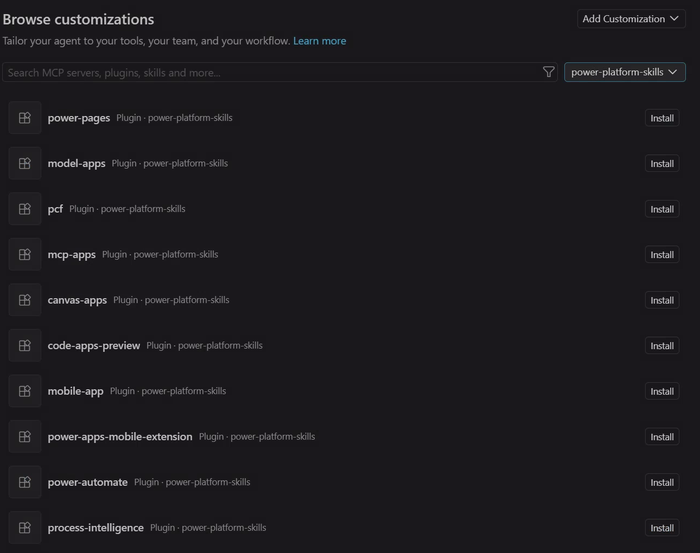
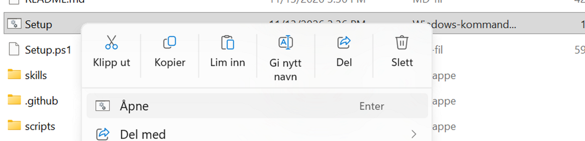
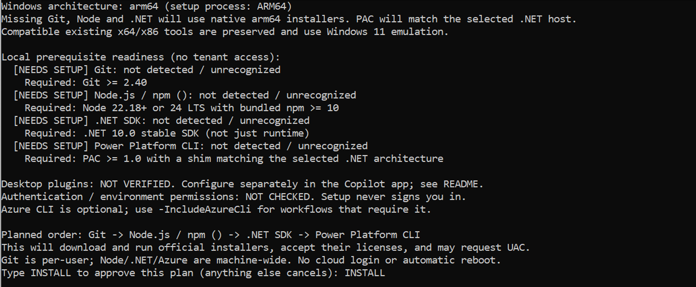
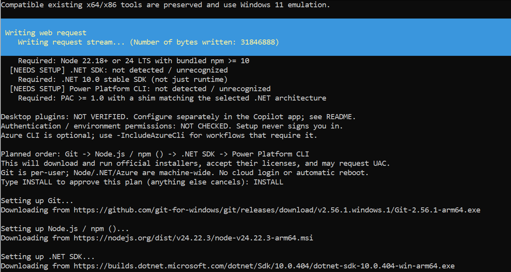
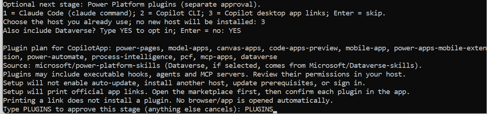

# Power Platform setup for Windows

**Download, extract, then choose Setup or your coding agent.** This helps you prepare a Windows PC to use
Microsoft's Power Platform plugins with **GitHub Copilot or Claude Code**.
You must already have your chosen app installed.

Use the **same Setup.cmd** on Intel/AMD x64 PCs and ARM64 Windows 11 PCs.
It checks your computer, shows a plan, and asks before installing anything.
The installer does not sign you in or create anything in your Microsoft
environment. Optional agent-guided connection onboarding has separate approvals.

Follow these three steps:

1. [Install the Windows tools](#step-1-install-the-windows-tools).
2. [Choose and install Power Platform plugins](#step-2-choose-and-install-power-platform-plugins).
3. [Connect to your environment](#step-3-connect-to-your-environment), only when ready.

## Step 1: install the Windows tools

1. **Download:** on [this repository](https://github.com/danieag/power-platform-setup),
   click **Code > Download ZIP**.
2. **Extract:** right-click the ZIP, choose **Extract All**, and open the extracted
   folder containing `Setup.cmd` and `Setup.ps1`.

Now choose **Alternative A or B**, not both at the same time. They use the
same setup script and approval rules. Keep all extracted files together.

### Alternative A: run Setup yourself

1. **Run:** review the downloaded script, then double-click **Setup.cmd**
   (Windows may show it simply as **Setup**). You do not need to open PowerShell.
2. **Approve:** read the plan, type **INSTALL**, and press **Enter**.
   Setup installs missing tools in this order:
   **Git > Node.js/npm > .NET 10 SDK > PAC CLI > Azure CLI**.
   Compatible tools already installed are skipped.
   Existing Node **22.18+ (22.x), 24 or 26** is preserved when bundled npm is
   version 10+ and the executable architecture is compatible. New Node installs
   still use **24 LTS**; setup does not downgrade a compatible Node 26 install.
3. **Wait, then answer the optional prompts** below. Keep this window open.
   When finished, restart your chosen app and terminals.

For the CLI doctor in **Step 2**, press **Enter** at the optional Power Platform
plugin host prompt to skip the built-in full-set route. You will choose your
individual plugins with the doctor instead. Other optional stages still have
their own approvals; no sign-in happens here.

### Alternative B: use your coding agent

1. Open your coding agent and **add the extracted local folder to the session**.
   In the Copilot desktop app, click **+ > Add local folder or repository** and
   select the folder containing `AGENTS.md`, `README.md`, and `Setup.ps1`.
   In Claude Code, open/start it in that folder. You do not need to initialize
   a Git repository or install Git just to open the extracted folder.
2. Use an agent session that can run local terminal commands, with normal
   interactive approvals. If the app asks you to trust the folder, review it
   and make that decision yourself; do not enable blanket auto-approval.
3. Paste this **one starting prompt**. The bundled
   [power-platform-setup entry skill](skills/power-platform-setup/SKILL.md)
   coordinates the script, doctor and connection skill for you:

> Read `AGENTS.md`, `README.md`, `Setup.ps1`, and
> `skills/power-platform-setup/SKILL.md` from this extracted setup folder.
> Follow that entry skill as one guided onboarding flow using my existing
> Copilot CLI or Claude Code CLI. Confirm the intended host if unclear.
>
> First run `.\Setup.cmd -CheckOnly`, explain the prerequisite plan, and ask
> before installing anything. Once tools are ready, follow
> `skills/power-platform-doctor/SKILL.md`: ask before adding Microsoft's
> official marketplace, then ask which Power Platform plugins I want.
> Show the selected-plugin plan and install only what I approve.
>
> Finally continue with `skills/power-platform-connect/SKILL.md`.
> Confirm my account, Tenant ID, Environment URL and selected tools, and ask
> separately before additional software, sign-in, profile/configuration
> changes, MCP registration/startup or live identity checks.
>
> Keep guiding me in this conversation where possible. If PATH changes,
> new plugins/MCP tools, or Windows require a restart, explain why and give
> me a short resume prompt showing what is complete and what comes next.
> Do not close the host for me or repeat working installations.
> Do not install another agent host, enable blanket auto-approval, change
> tenant permissions, or create cloud resources. For a native app/IDE
> without a CLI, explain the supported manual route instead.

**One starting prompt, separate approvals.** You do not need to discover and
paste each skill's prompt yourself. Keep the **complete extracted folder**
available; attaching only a README or launcher is insufficient.

**A restart may still be necessary.** A running host keeps its old PATH, and
some versions load plugins/MCP tools only after a reload or restart. Reopen
after PATH changes; otherwise pause only when the required capability is not
available. Your agent should finish approved local stages where possible,
give the resume prompt, and continue the guided flow after you return.
There is no promise that one conversation can remain uninterrupted through
Windows reboots, host-close requirements, or new MCP discovery.

`AGENTS.md` is an instruction file for the agent, **not a program you run**.
The agent checks first, explains the plan, and runs the same installer after
your approval. It can use the script's noninteractive flags after that approval,
so you may approve in chat rather than typing the terminal keywords yourself.
Windows administrator prompts and Copilot desktop plugin confirmations may
still need your action.

If Windows blocks running `Setup.ps1` directly, use **`Setup.cmd`** instead,
including for `-CheckOnly`. The launcher is the intended entry point and uses
a child-process-only policy exception; do not change persistent execution policy.
Enterprise restrictions can still block it and should be handled by your IT team.

<details>
<summary>Screenshots: add the local folder, then send the prompt</summary>

Choose **Add local folder or repository** (unrelated recent projects have been
cropped out):


The extracted folder is attached to the session before the prompt is sent:



This screenshot shows an earlier installation-only prompt. Use the current
one above to request the full guided flow through connection onboarding.

</details>

### Approvals and next steps for either alternative

Only run code you trust. If unsure, ask your IT administrator or agent to review
`Setup.ps1` first. Start setup as your **normal user**, not "Run as administrator";
Windows can ask separately when an individual installer needs admin permission.
Follow your organization's restrictions rather than disabling Windows protections.

For Alternative A, the terminal prompts are below. For Alternative B, the agent
guides the same stages and requests the corresponding approval in chat.

| Setup asks about... | What to do |
|---|---|
| Power Platform plugins | For individual CLI plugin choices, press **Enter** and continue to **Step 2's doctor**. The existing full-set route is still available: **1** = Claude Code, **2** = Copilot CLI, **3** = Copilot desktop links; type **PLUGINS** to approve that plan. Dataverse is optional: type **YES** when asked if you need it. |
| Copilot desktop links (option 3) | Open the **marketplace link first**, then each desired plugin link. Confirm each installation in the app. **Printing links does not install the plugins.** |
| Copilot Studio MCP | This gives your agent access to Copilot Studio tools. Choose your app, close that app as instructed, then type **MCP** to approve saving the connection setup. It does not sign you in. |
| Connection skill | Choose your app, then type **SKILL** to copy the instructions for later sign-in. Installing a skill does **not** run it. |

Press **Enter** at an optional host chooser to skip that stage. Other text at an
approval prompt cancels that stage; earlier successful installs stay installed.
Setup never installs another agent app just to make a host command available.

## Step 2: choose and install Power Platform plugins

### Copilot CLI or Claude Code: use the doctor skill

The bundled [power-platform-doctor skill](skills/power-platform-doctor/SKILL.md)
first prepares Microsoft's marketplace with your approval, then asks
**which plugins you want**, checks what is installed, shows a plan, and installs
**only your approved selection**. For example, you can choose just **Dataverse
and Model Apps**, rather than installing every plugin.

Use your **already installed GitHub Copilot CLI or Claude Code CLI**. Open it
in the extracted setup folder, or continue the guided installation chat that
already has access to that folder. If you started with Alternative B's single
prompt, the agent continues here automatically; you need not paste this again.
For Step 2 on its own, paste:

> Read `skills/power-platform-doctor/SKILL.md` in this extracted setup folder
> and follow it as Step 2. Confirm my existing CLI host, ask before adding
> Microsoft's marketplace, then ask which Power Platform plugins I want.
> Check what is already installed, show the selected-plugin plan, and ask
> before making changes.
> Install only my approved selection. Do not install another agent host,
> sign in, invoke tenant tools, or change cloud resources.

This skill is included in the download; it is **not automatically copied into
your personal skills directory**. Reading the file as above works without
claiming a `/power-platform-doctor` command is already registered.

The doctor keeps matching existing plugins, leaves unselected plugins alone,
and does not change the other CLI.
After installation, confirm its skills/tools appear, using the host's supported
reload/restart when required. Reopen after PATH changes. A plugin registration is not proof of authentication or
that every bundled MCP server is connected. Dataverse **CLI** installation
and sign-in are later connection-onboarding decisions, not this plugin step.

If you already installed plugins in Step 1, the doctor can check and retain
them. Do not run a second broad curl/Node installer. Without an existing CLI,
use the native VS Code route below or Copilot desktop's marketplace/plugin
confirmation links from the optional setup prompt; no extra CLI is required.

### Manual option: add the Power Platform plugins in VS Code

You can use VS Code's normal marketplace controls instead of a CLI installer.
**Copilot CLI and Claude Code are not required for this route**, but Git must be
installed and discoverable by VS Code. After installing Git, fully exit and
reopen VS Code so it picks up the updated PATH.

1. Open **Customizations** (or **Customize**) and choose **Browse**.
2. Open the source dropdown beside the search box (often **All Sources**),
   then choose **Configure Marketplaces**.
3. Choose **Add Marketplace...**, enter **`microsoft/power-platform-skills`**,
   and press **Enter**.
4. Back on **Browse**, select **power-platform-skills** in the source dropdown.
   If it was already added, just select it rather than adding a duplicate.
5. Choose the plugins you want and select **Install** for each. Include
   **dataverse** if you need it. Review any permissions/trust prompts, then check
   the installed plugins list and reload/restart if VS Code asks.

**Adding the marketplace only shows the catalog; it does not install every
plugin.** Plugins can contain skills, agents, hooks and MCP tools. Installation
still does not sign you in or prove that every tool is connected.
Menu wording can vary by VS Code version; the Command Palette alternative is
**Chat: Manage Plugin Marketplaces > Add Marketplace...**.

<details>
<summary>Screenshots: configure the marketplace, add its source, and choose plugins</summary>

From **Customizations > Browse**, open the source dropdown and choose
**Configure Marketplaces**:


Choose **Add Marketplace...**:


Enter **microsoft/power-platform-skills** and press **Enter**:


Select **power-platform-skills** to browse the available plugins. Select
**Install** beside each one you want; a visible Install button does not mean
that plugin has already been installed:



</details>

If Git runs by its full path but VS Code cannot find `git`, **do not reinstall
it immediately**. A running app or its parent may still have the old PATH.
See [Git/PATH troubleshooting](docs/advanced-setup.md#exit-codes-and-troubleshooting)
before retrying the marketplace.

<a id="step-3-connect-in-a-fresh-chat"></a>

## Step 3: connect to your environment

With Alternative B's full-flow prompt, the agent now reads the bundled
connection skill and continues asking for your target and approvals. You do not
need another starting prompt or a personal skill copy.

If running this step separately, read/use the connection skill in your chosen
host and paste the request below. Reopen after PATH changes and follow any
required plugin/MCP reload first:

> Use the power-platform-connect skill to help me connect my Dataverse CLI,
> PAC CLI, Azure CLI, and Dataverse MCP. Check existing profiles first.
> Confirm my account, tenant, and environment, and ask before signing in or
> changing configuration. Reuse working sessions; do not change tenant permissions.

Remove anything you do not need; add Copilot Studio MCP if you also want its
sign-in. If the skill is missing or you skipped installation, ask the agent to
read [the connection skill](skills/power-platform-connect/SKILL.md) instead.
The agent can guide the commands; you still complete sign-in/MFA yourself.
Separate tools can require separate initial sign-ins. One universal login is
not guaranteed.

**See the [illustrated Power Platform Connect guide](docs/power-platform-connect-guide.md)**
for the questions, separate installation/sign-in approvals, private connection
record, MCP registration, and post-restart verification. It uses redacted
screenshots from a user-reported run. Start with **power-platform-connect**;
you do not need to run Microsoft's full `dv-connect` workflow first.

<details>
<summary>Do I also run the official curl / Node Power Platform Skills installer?</summary>

**No extra command is needed when you use this setup's plugin stage.**
Our script uses the selected host's supported plugin commands: `claude` for
Claude Code or `copilot` for Copilot CLI. Copilot desktop-only users still
confirm the official installation links in the app.

The desktop app and CLI are separate installations. A terminal command that
asks **"Install GitHub Copilot CLI? [y/N]"** can be just an install launcher,
not proof that the full CLI is already installed. An agent should not silently
accept that prompt. You can use the desktop links without the CLI, or
independently install it using [GitHub's instructions](https://docs.github.com/en/copilot/how-tos/copilot-cli/set-up-copilot-cli/install-copilot-cli)
and ask the agent to recheck afterward. Declining that extra installation
does not prevent the desktop plugin-link route.

Installing the CLI or running plugin-management commands does not itself send
AI prompts. AI conversations/tasks, including the agent guiding this setup,
use the relevant plan's allowance. CLI AI use also needs the required access
and organization policy; installing a program does not buy or grant AI credits.
See [current GitHub billing guidance](https://docs.github.com/en/copilot/concepts/billing-and-usage/individuals/billing).

Microsoft's quick installer is a valid **alternative for existing CLI hosts**.
It can configure both detected CLIs, install/update prerequisites, and enable
auto-updates, so it is not silently added to this narrower setup. It also does
not replace the later connection/sign-in skill.

**That CLI requirement belongs to `install.js`, not to Power Platform skills.**
Copilot desktop users can install plugins normally through **Customize**.
VS Code agent-mode users can use **Chat: Manage Plugin Marketplaces > Add
Marketplace...**, enter `microsoft/power-platform-skills`, then install the
plugins from **Customize**. Neither native app route requires Copilot CLI.
The [manual walkthrough above](#manual-option-add-the-power-platform-plugins-in-vs-code)
shows the **Configure Marketplaces** menu route with screenshots.
See [GitHub's VS Code plugin instructions](https://docs.github.com/en/copilot/how-tos/copilot-in-your-ide/customize-copilot/extend-copilot-with-tools-and-context/using-plugins).
The script's `CopilotApp` links target the desktop app, not VS Code; there is
currently no `VSCode` host flag. Respect each host/plugin's support and policies.

If following that alternative on Windows, **`curl.exe`** names the actual curl
program; plain `curl` may mean PowerShell's `Invoke-WebRequest` alias. A download
alone does not install plugins, and piping a remote script into Node executes
it immediately. Have your agent review the source and explain its changes before
you approve execution. Do not run both installation routes unnecessarily.

</details>

<details>
<summary>What will the connection skill ask me? Wasn't Dataverse already installed?</summary>

| Question | What it means |
|---|---|
| Environment URL | The web address of your Power Apps / Dataverse environment, for example `https://yourorg.crm4.dynamics.com`. It is not the general maker-portal address. |
| Tenant ID / Directory ID | The ID of your Microsoft organization. Find it in **Microsoft Entra admin center > Entra ID > Overview > Properties > Tenant ID**, after selecting the directory that owns your environment. It is **not** an Azure Subscription ID, PPAC Environment ID, or Dataverse Organization ID. |
| Work sign-in email (UPN) | The username you use to sign in, usually your work or school email address. It can differ from your email mailbox address. |
| Connection nickname (alias) | A friendly local name you choose, such as **`my-demo-environment`**. It helps the agent remember this connection; it does not rename your actual environment. |
| Tools to connect | Which tools you want to sign into or connect to chat. The agent should explain the choices, not assume you need every tool. |

**An Azure Subscription ID is not normally needed for this connection setup.**
It identifies an Azure resource/billing subscription, not your Microsoft
organization. The agent should not ask for it unless your separate Azure task
actually needs one. [How to find your Tenant ID](https://learn.microsoft.com/en-us/entra/fundamentals/how-to-find-tenant).

If PPAC's environment details show **Organization ID** and **Environment ID**,
neither is the Tenant ID. In **Microsoft Entra admin center**, select the
organization that owns the environment, then open **Entra ID > Overview >
Properties > Tenant ID**. Ask the tenant's administrator if you cannot access it.

**PAC CLI, the Dataverse plugin, and Dataverse CLI are different things.**
Setup installs **PAC CLI** (`pac`). The optional **Dataverse plugin** gives your
agent instructions and tools. The separate **Dataverse CLI** (`dataverse`) is
the npm package `@microsoft/dataverse`; it is not included in the base
prerequisite install.

The connection skill should **check whether that CLI is already installed
before asking to install it**. If it is missing and you want its commands/MCP
proxy, the agent explains the extra download and asks for approval then.
"Globally via npm" means making the command available outside one project,
using Node.js's package manager; it does not grant cloud access or sign you in.

Already installed an older copy of the connection skill? Setup deliberately
does not overwrite different skill content. Ask your agent to read the
[updated public skill](skills/power-platform-connect/SKILL.md), or review and
intentionally update your personal copy.

</details>

### Keeping compatibility rules current

A weekly **Review tool versions** GitHub Actions workflow checks official Node
release and support metadata. Newly released, still-supported LTS majors can
produce a **review pull request** updating the accepted versions, regression
cases, and guidance. It never approves or merges the PR, changes your computer,
or adds online checks to `Setup.cmd -CheckOnly`.

The current automation covers **Node LTS additions**, not automatic upgrades
of every tool's major version. New-install defaults stay unchanged; maintainers
review plugin compatibility and end-of-life warnings. See
[version maintenance](docs/advanced-setup.md#automatic-version-maintenance).
Download/extract a newer repository version after an approved update is merged;
an existing downloaded ZIP does not update itself.

## Walkthrough with screenshots

These are cropped screenshots from a user-reported **ARM64 Windows Sandbox**
run of an older version. **Some show Azure CLI as optional; the current version
includes it after PAC.** Version numbers, language, and prompts can differ.
They show the workflow, not proof that every current feature has passed a
complete clean-machine test.

### 1. Download the ZIP

Use GitHub's green **Code** button and choose **Download ZIP**.
Download the whole repository, not just `Setup.cmd`.


### 2. Extract it and open Setup

Use **Extract All**, then open the folder that contains these files.
Do not run setup from inside the ZIP. Keep `Setup.ps1`, the `skills` folder,
and the other downloaded files together.


Double-click **Setup** / **Setup.cmd**, or right-click and choose **Open**
(the highlighted command in the supplied Norwegian screenshot). Do not choose
**Run as administrator** for the whole setup.



### 3. Read the check and type INSTALL

The first check is called the **preflight**. `[READY]` means a compatible tool
was found. `[NEEDS SETUP]` means it needs installation or attention.
Nothing is downloaded until you approve the installation plan.



### 4. Allow time for downloads and installation

**The .NET SDK stage can take much longer than the others.** In the reported
Sandbox session it took over an hour around this stage. That is one user's
experience, not an expected duration or a reason to ignore a reported failure.
Windows/connection speed can vary, and the download can time out.

While a vendor installer is running, the current script prints a **"Still
waiting" message about every 30 seconds**, with elapsed time. This is a heartbeat,
not a percentage, proof of package progress, or an estimated finish time.
Downloads and PAC's .NET tool command have their own output and are not covered
by this installer heartbeat.

Keep the window open while it is working and check for a Windows permission
prompt. Do not start a second setup while an installer is still running.
If setup reports **failed**, use [the recovery steps below](#if-setup-shows-an-error).

<details>
<summary>Screenshot: downloading the .NET SDK</summary>



</details>

### 5. Choose the app for plugins

For **Copilot desktop**, choose **3**. Option **2** is for users who already
have the `copilot` terminal command; installing the desktop app alone does not
guarantee that command exists.

If requested, type **YES** for Dataverse, then review the plugin plan and type
**PLUGINS**. For option 3, open the printed links and confirm in the app.
Check **Customize > Installed** afterward.

<details>
<summary>Screenshot: choosing Copilot desktop and approving the plugin plan</summary>



</details>

Keep following the window for optional **MCP** and **SKILL** setup, then use
the [sign-in prompt above](#step-3-connect-to-your-environment) in your app. Sign-in is not started
by the installer.

## If setup shows an error

**A red error or exit code `3` is not a successful installation.**
Pressing Enter at "Press any key to continue" only closes the finished window.

In the supplied run, setup reported:

```text
Setup failed: Access to the path 'dotnet.exe' is denied.
Setup exit code: 3
```

<details>
<summary>Screenshots: the .NET error, and the SDK detected on a later run</summary>


On the later run, the check showed the .NET SDK as ready:


</details>

That later result **does not explain or fix the original error**. To check safely:

1. Let any active installer finish. If Windows asks for a restart, save your
   work and restart yourself. Do not run overlapping installers.
2. Open a new terminal in the extracted setup folder and run:

   ```powershell
   .\Setup.cmd -CheckOnly
   ```

   This only checks; it does not download, install, sign in, or open app links.
3. If .NET is now `[READY]` and PAC is still `[NEEDS SETUP]`, run `Setup.cmd`
   again, review the remaining plan, and approve it. Compatible installed tools
   are skipped. If the error repeats or .NET is still missing, stop and seek
   help using the exact error and exit code, with personal details removed.

Do not disable security software, change persistent PowerShell policy, or
assume administrator mode is the fix. See
[detailed troubleshooting and exit codes](docs/advanced-setup.md#exit-codes-and-troubleshooting).

## Detailed version

Read the [full technical guide](docs/advanced-setup.md) for all options, supported
Windows versions, download verification, architecture handling, authentication,
and contributor tests. Only install vendor tools on a supported Windows version.
On ARM64, Azure CLI uses the official x64 package under Windows 11 emulation.

For an agent-led start, ask it to read [AGENTS.md](AGENTS.md), check readiness,
and explain the plan before installing anything. CLI plugin choices use the
[Step 2 doctor](skills/power-platform-doctor/SKILL.md); native app/IDE routes
and optional MCP setup use the [integration skill](skills/power-platform-integrations/SKILL.md).

This community bootstrap is not a Microsoft product. It never creates cloud
resources or enables agent auto-approval. Setup behavior has automated local
tests; full vendor installation, actual app discovery, and live authentication
are separate acceptance checks. [MIT license](LICENSE); vendor tools have their
own licenses.

**Latest user-reported ARM64 Sandbox result:** Git, Node.js/npm, .NET SDK, PAC,
and x64 Azure CLI under emulation completed. Copilot desktop plugin links were
printed (plugins not installed); MCP configuration and the skill file were saved
after a workaround for the then-incorrect default `COPILOT_HOME` rejection.
The current script accepts that default path without clearing the variable.
Actual app discovery and live sign-in were not tested in that run.
