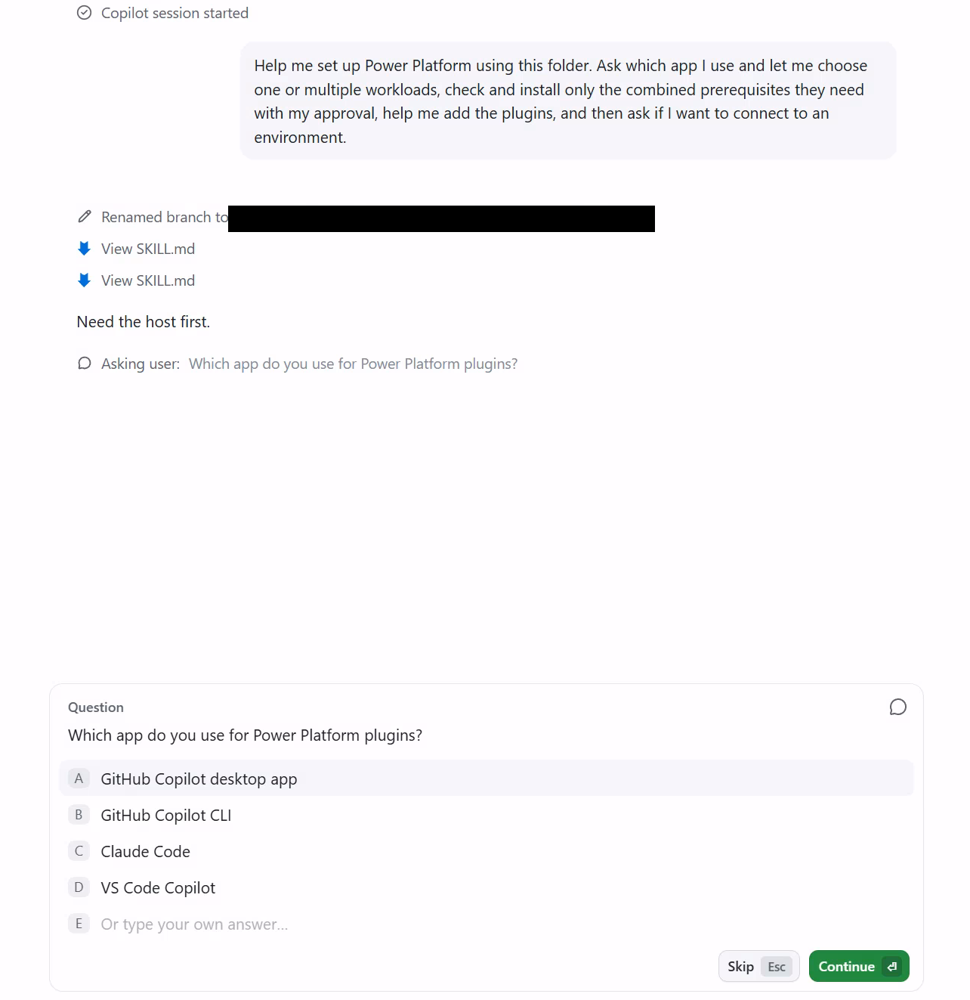
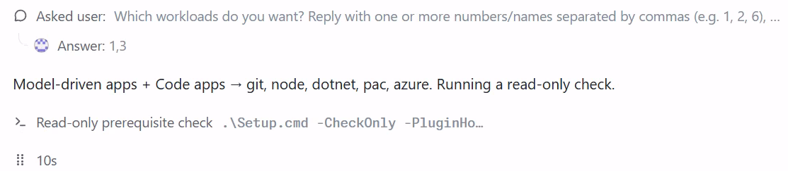
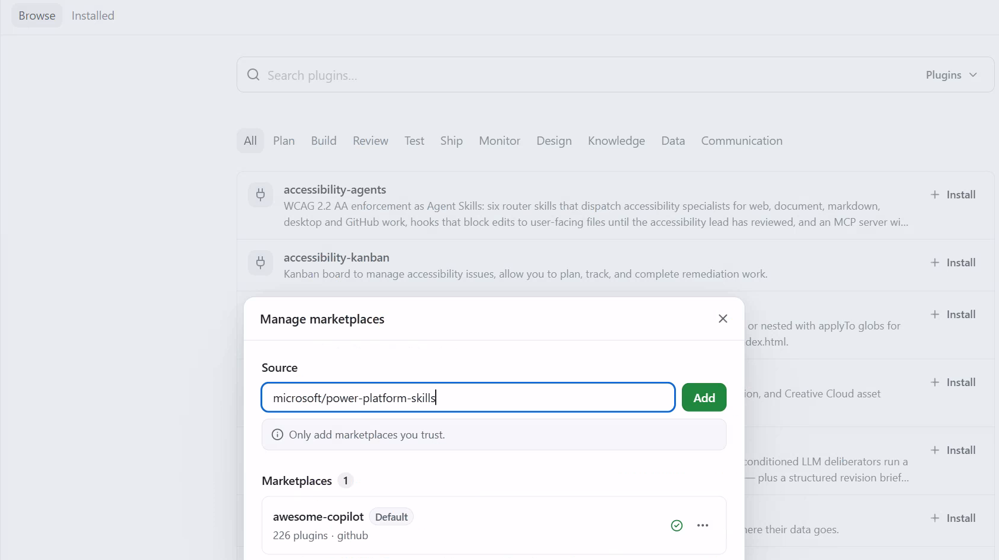
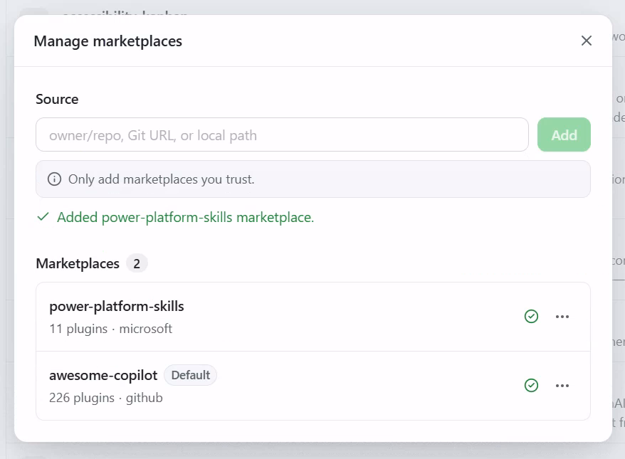
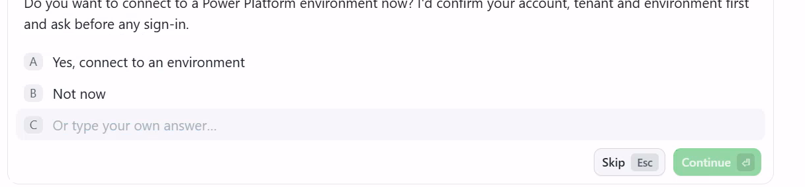

# Illustrated agent-guided setup walkthrough

[Back to the main README](../README.md)

This walkthrough shows what happens when you open the extracted
`power-platform-setup` folder in the **GitHub Copilot desktop app** and send
one short prompt—choosing multiple Power Platform workloads, checking only
their combined Windows prerequisites, adding Microsoft's official marketplace,
installing your chosen plugins step by step, and optionally connecting to a
Power Platform environment.

Any branch or personal identifiers in user-reported screenshots have been
redacted; public marketplace URIs (`microsoft/power-platform-skills`) are kept
as-is.

---

## 1. Open the extracted folder and paste the short prompt

Add/open the extracted folder in the GitHub Copilot desktop app (**+ > Add local
folder or repository**), then paste the short prompt from the
[README](../README.md#alternative-b-download-this-folder-and-run-one-prompt-in-your-agent)
(or ask directly in plain English, such as *"Install the prerequisites and
plugins for Model-driven apps and Code apps"*):

> Help me set up Power Platform using this folder. Ask which app I use and let me choose one or multiple workloads, check and install only the combined prerequisites they need with my approval, help me add the plugins, and then ask if I want to connect to an environment.

---

## 2. Choose which app you use

The workspace skill (`power-platform-setup`) loads automatically and asks which
app should receive the Power Platform plugins (**GitHub Copilot desktop app**,
**GitHub Copilot CLI**, **Claude Code**, or **VS Code Copilot**). Choosing a
host only scopes the plan—it does not install anything yet.

---

## 3. Select one or multiple workloads

Next, the agent presents all 11 official Power Platform workloads as a numbered
list so you can pick **several at once** in a single reply (for example `1,3`
for **Model-driven apps** + **Code apps**, `all`, or `marketplace` for
marketplace only):

---

## 4. Check only the combined Windows prerequisites

`Setup.cmd -CheckOnly -Plugins "..." -Prerequisites FromPlugins` computes the
exact union of Windows tools required by your chosen workloads (for example,
`Model-driven apps + Code apps` resolves `git, node, dotnet, pac, azure`;
whereas `Canvas apps + Code apps` resolves only `git, node, dotnet`) and runs an
offline, read-only check:

If any required prerequisites are missing, the agent explains the exact plan
and asks for your approval before installing anything. When all required tools
are already `[READY]`, nothing is downloaded or reinstalled.

---

## 5. Approve adding the Power Platform marketplace

Before opening any plugin prompts in the GitHub Copilot desktop app, the agent
asks for separate marketplace/plugin approval:

---

## 6. Confirm the marketplace inside the Copilot desktop app

Once approved, `Setup.cmd -PluginHost CopilotApp -MarketplaceOnly` triggers the
local `ghapp://plugins/marketplace/add?source=microsoft%2Fpower-platform-skills`
handler directly—opening the native **Add plugin marketplace?** dialog inside
the Copilot app without opening a web browser. Click **Allow**:

In **Manage marketplaces**, `microsoft/power-platform-skills` is pre-filled.
Click **Add**:

Wait a few seconds while Copilot adds the catalog (`Adding marketplace...`):

Confirm that **`✓ Added power-platform-skills marketplace.`** (`11 plugins · microsoft`)
appears under **Marketplaces**:

---

## 7. Confirm each selected plugin before environment connection

Because Copilot desktop app confirmations happen inside the app UI (`exit 4`),
the agent **waits for you to confirm that the marketplace is added first**, and
then opens the install prompt for each workload you selected one by one (using
`Setup.cmd -PluginHost CopilotApp -Plugins "<plugin-id>" -SkipMarketplace`,
which triggers `ghapp://plugins/install?source=<plugin-id>%40power-platform-skills`
directly in the app, or you can click **+ Install** beside them in **Customize >
Browse**).

Check **Customize > Installed** to verify your chosen plugins are enabled.

---

## 8. Optional: connect to your Power Platform environment

Only **after** your marketplace and selected plugins are confirmed does the
agent ask whether you want to connect to a Power Platform environment:

If you choose **Yes, connect to an environment**, follow the
[illustrated Power Platform Connect guide](power-platform-connect-guide.md) to
sign in with PAC CLI, pick one or more environments from `pac env list` (or
enter an existing URL), and register your selected tools.
