# Illustrated agent-guided setup walkthrough

[Back to the main README](../README.md)

This walkthrough shows what happens when you open the extracted
`power-platform-setup` folder in the **GitHub Copilot desktop app** and send
one short prompt—choosing multiple Power Platform workloads, checking only
their combined Windows prerequisites, adding Microsoft's official marketplace,
installing your chosen plugins step by step, and optionally connecting to a
Power Platform environment.

Any branch or personal identifiers in user-reported screenshots have been
redacted; public marketplace URIs (`microsoft/power-platform-skills`) are kept
as-is.

---

## 1. Open the extracted folder and paste the short prompt

Add/open the extracted folder in the GitHub Copilot desktop app (**+ > Add local
folder or repository**), then paste the short prompt from the
[README](../README.md#alternative-b-download-this-folder-and-run-one-prompt-in-your-agent)
(or ask directly in plain English, such as *"Install the prerequisites and
plugins for Model-driven apps and Code apps"*):

> Help me set up Power Platform using this folder. Ask which app I use and let me choose one or multiple workloads, check and install only the combined prerequisites they need with my approval, help me add the plugins, and then ask if I want to connect to an environment.

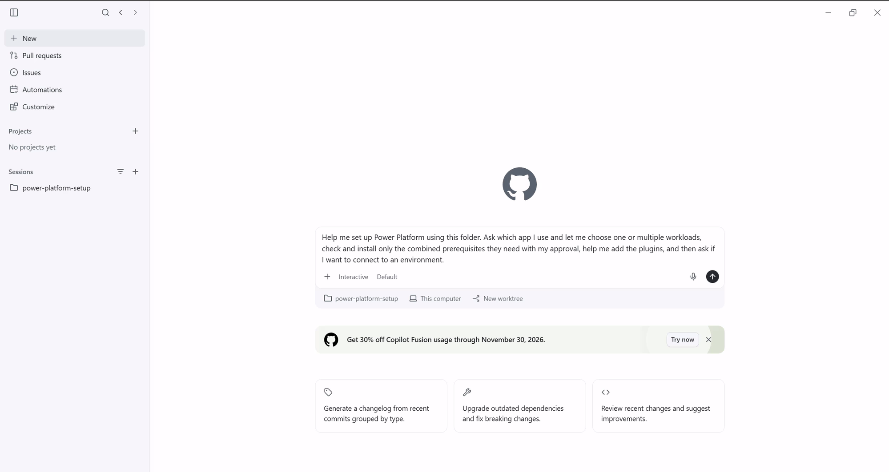

---

## 2. Choose which app you use

The workspace skill (`power-platform-setup`) loads automatically and asks which
app should receive the Power Platform plugins (**GitHub Copilot desktop app**,
**GitHub Copilot CLI**, **Claude Code**, or **VS Code Copilot**). Choosing a
host only scopes the plan—it does not install anything yet.

---

## 3. Select one or multiple workloads

Next, the agent presents all 11 official Power Platform workloads as a numbered
list so you can pick **several at once** in a single reply (for example `1,3`
for **Model-driven apps** + **Code apps**, `all`, or `marketplace` for
marketplace only):

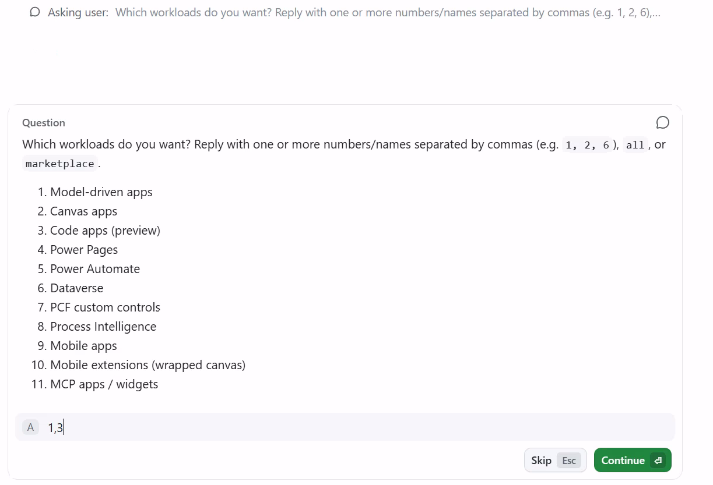

---

## 4. Check only the combined Windows prerequisites

`Setup.cmd -CheckOnly -Plugins "..." -Prerequisites FromPlugins` computes the
exact union of Windows tools required by your chosen workloads (for example,
`Model-driven apps + Code apps` resolves `git, node, dotnet, pac, azure`;
whereas `Canvas apps + Code apps` resolves only `git, node, dotnet`) and runs an
offline, read-only check:

If any required prerequisites are missing, the agent explains the exact plan
and asks for your approval before installing anything. When all required tools
are already `[READY]`, nothing is downloaded or reinstalled.

---

## 5. Approve adding the Power Platform marketplace

Before opening any plugin prompts in the GitHub Copilot desktop app, the agent
asks for separate marketplace/plugin approval:

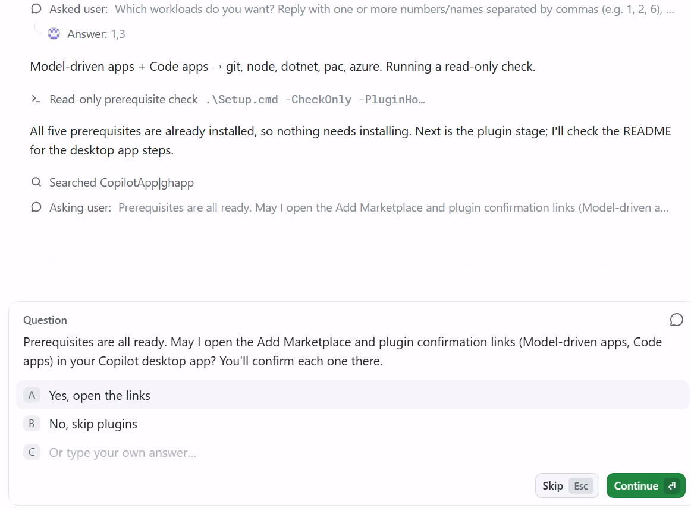

---

## 6. Confirm the marketplace inside the Copilot desktop app

Once approved, `Setup.cmd -PluginHost CopilotApp -MarketplaceOnly` triggers the
local `ghapp://plugins/marketplace/add?source=microsoft%2Fpower-platform-skills`
handler directly—opening the native **Add plugin marketplace?** dialog inside
the Copilot app without opening a web browser. Click **Allow**:

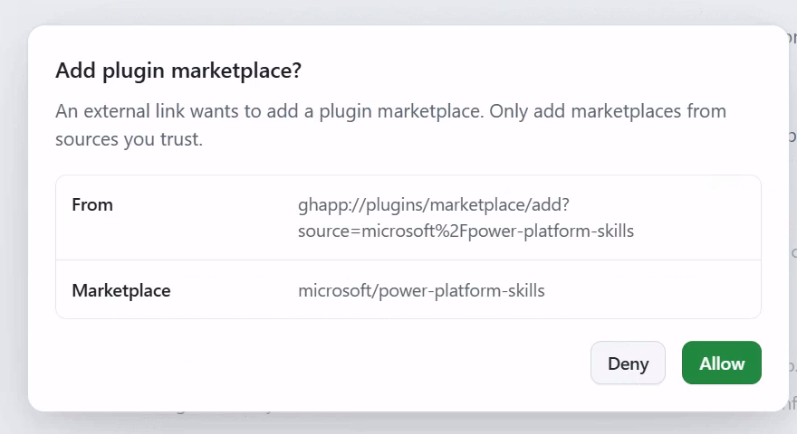

In **Manage marketplaces**, `microsoft/power-platform-skills` is pre-filled.
Click **Add**:

Wait a few seconds while Copilot adds the catalog (`Adding marketplace...`):

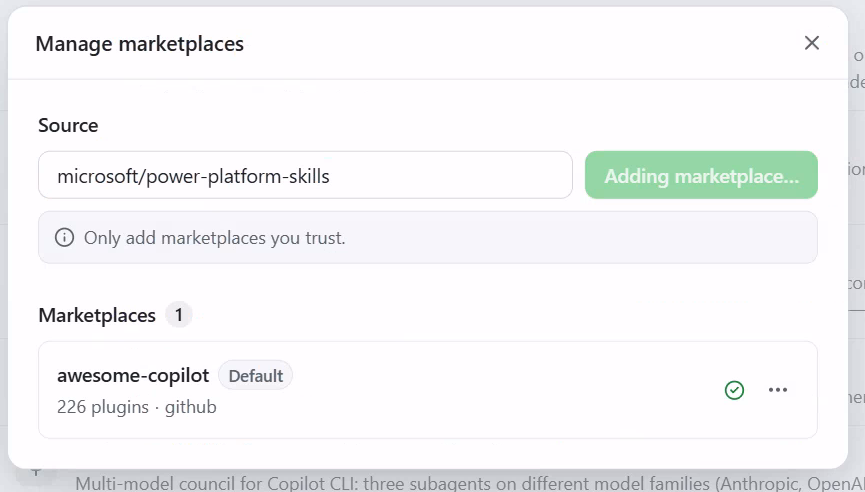

Confirm that **`✓ Added power-platform-skills marketplace.`** (`11 plugins · microsoft`)
appears under **Marketplaces**:

---

## 7. Switch back to your setup session and confirm each selected plugin

Adding a marketplace or plugin opens the **Customize** view in the GitHub
Copilot desktop app. Click back on your active setup session in the left
sidebar under **Sessions** (marked with the yellow question icon indicating the
agent is waiting for your confirmation):

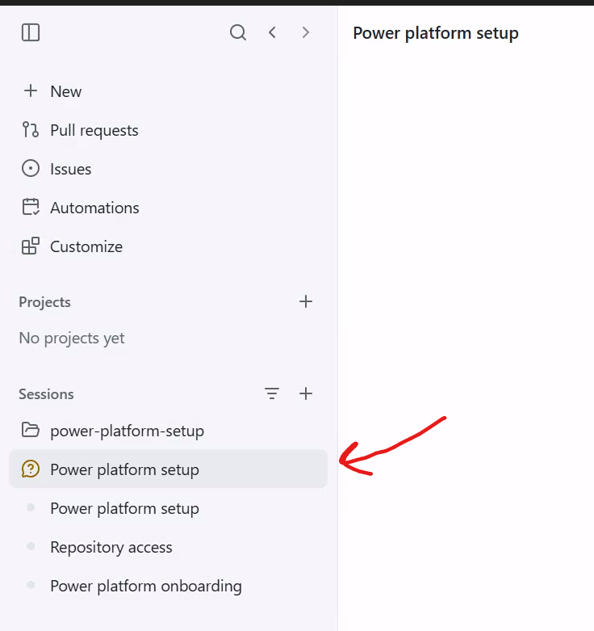

Select **Marketplace added** and click **Continue**:

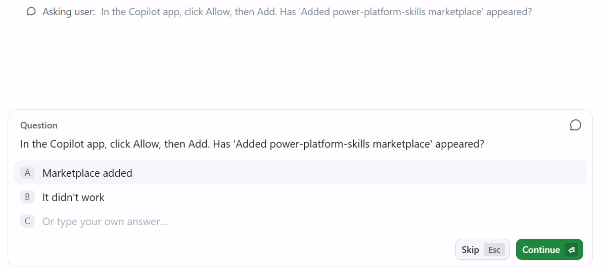

The agent now opens the install prompt for **each workload you chose at the
start**, one at a time, so dialogs never stack on top of each other. First,
`model-apps@power-platform-skills` opens—click **Allow**:

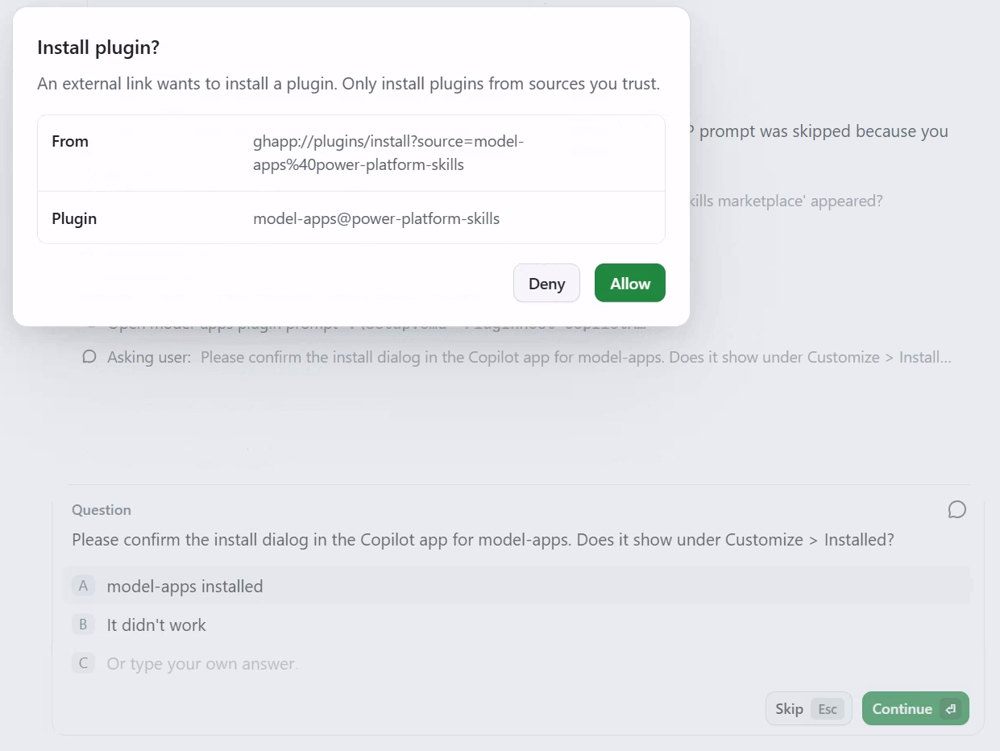

Then click **Install** in the Customize modal, return to your setup session in
the sidebar, and confirm **`model-apps installed`**:

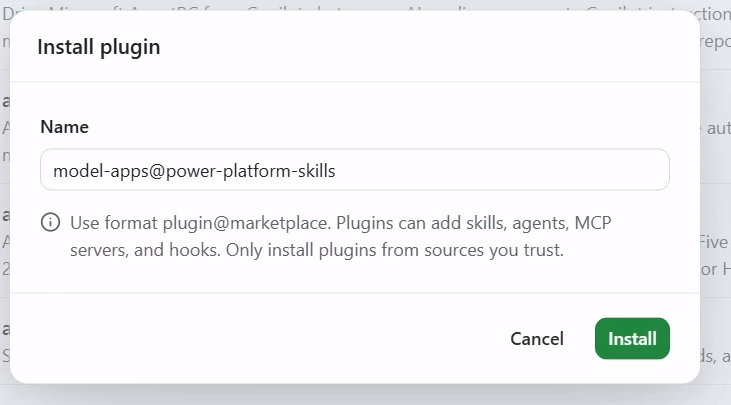

Next, the agent opens your second chosen plugin,
`code-apps-preview@power-platform-skills`—click **Allow**:

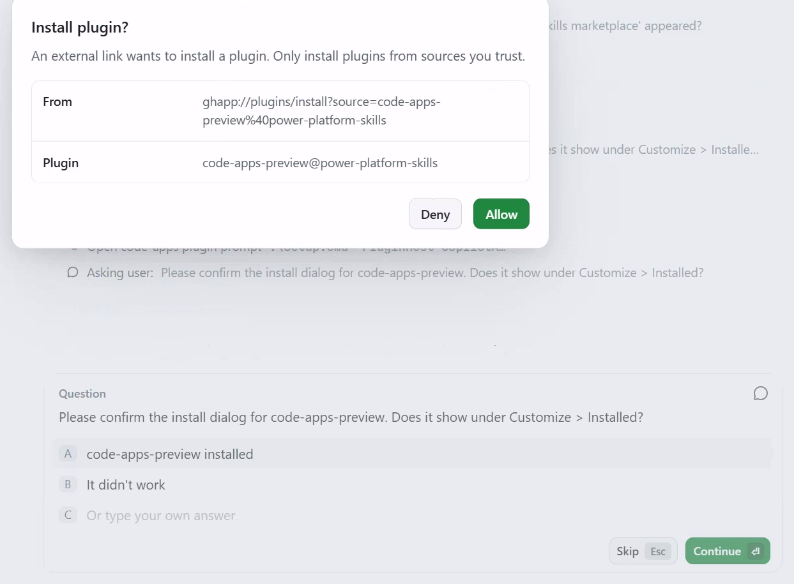

Click **Install**, return to your setup session in the sidebar, and confirm
**`code-apps-preview installed`**:

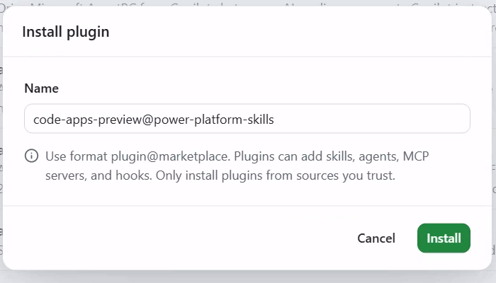

---

## 8. Optional: connect to your Power Platform environment

Only **after** all selected plugins are confirmed in place does the agent ask
whether you want to connect to a Power Platform environment (sensitive
environment URLs, admin emails, organization names, device codes, and local
paths below have been redacted):

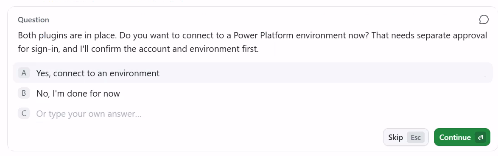

1. **Enter your environment URL (or type `discover`):** enter an existing
   Dataverse URL (such as `https://yourorg.crm.dynamics.com`) or type `discover`
   to list environments after signing in:

   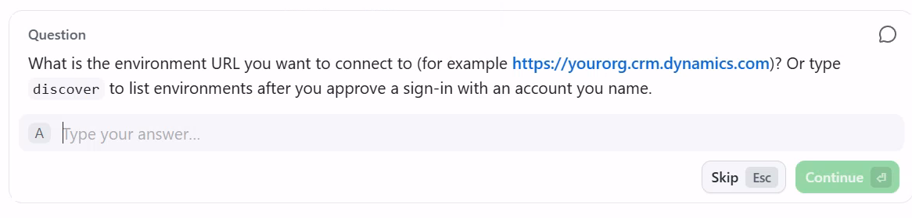

2. **Provide your work/school sign-in email and approve PAC sign-in:** the agent
   confirms the exact account and target environment URL before running any
   authentication command:

   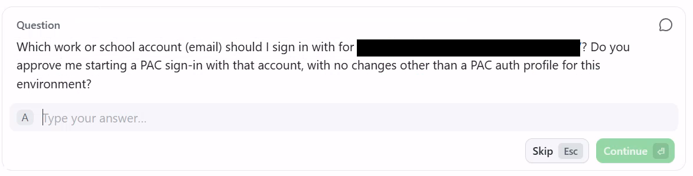

   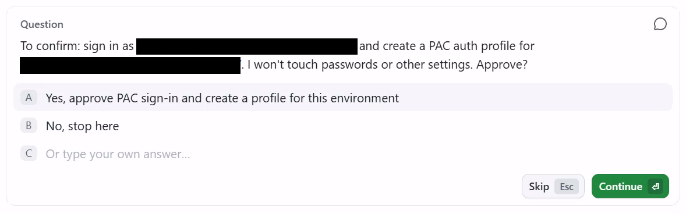

3. **Complete interactive / device-code sign-in in your browser:** PAC CLI
   displays a one-time device code for `https://login.microsoft.com/device` (or
   opens your browser). Enter the code and approve sign-in with your Microsoft
   Entra account:

   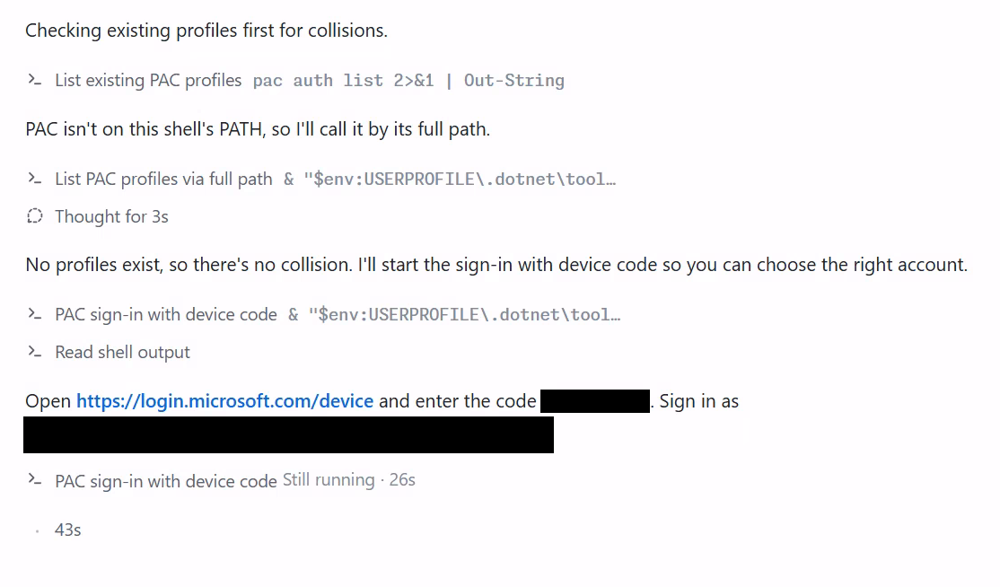

   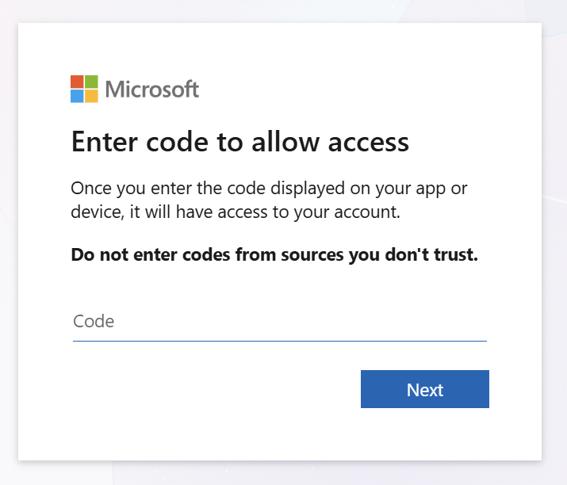

   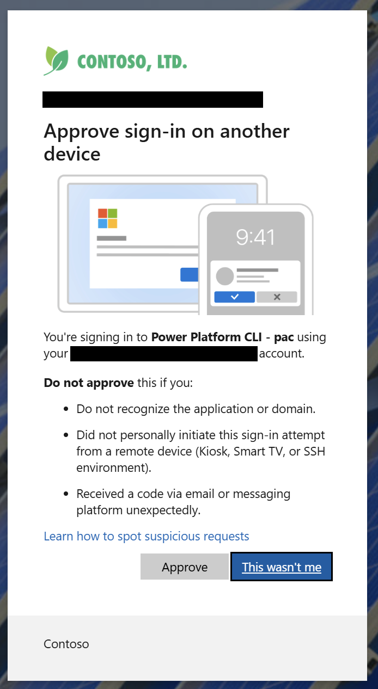

   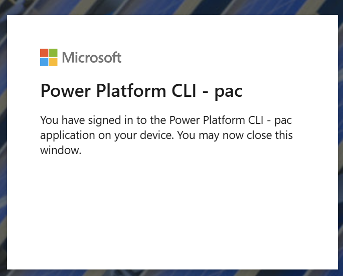

4. **Review the completion summary:** the agent reports prerequisites, confirmed
   plugins, and your active PAC profile separately, and reminds you to reopen
   your terminal/app if `PATH` changed during this session:

   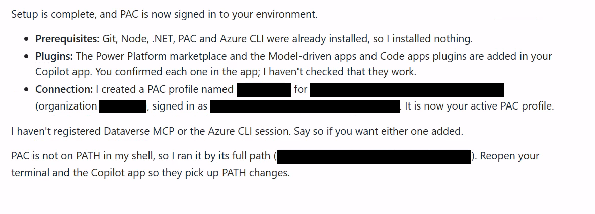

For multi-surface setup (Dataverse CLI, Dataverse MCP registration, and
tenant-isolated Azure CLI caches), see the companion
[Power Platform Connect guide](power-platform-connect-guide.md).
