# Media Bank — Complete Onboarding, Connection & Router Screenshot Catalog

[Back to README](../README.md) · [Agent-Guided Setup Walkthrough](agent-guided-setup-guide.md) · [Power Platform Connect Guide](power-platform-connect-guide.md)

This media bank indexes **every screenshot in the repository** with descriptive titles, file paths, dimensions, and plain-English descriptions so assets can be reused directly in **PDF guides, slide decks, or video walkthroughs**.

All tenant URLs, sign-in emails, Tenant/Environment/Organization GUIDs, and one-time device codes have been permanently redacted and verified clean with OCR.

---

## Part 1 — End-to-End Agentic Flow (`docs/media-bank/01..41`)

This 41-screenshot sequence captures the complete journey from opening the repository to verifying all **six** Power Platform tools (**Dataverse MCP**, **Dataverse CLI**, **PAC CLI**, **Azure CLI**, **Flow Agent MCP**, and **Copilot Studio MCP**) through `power-platform-router`.

### Chapter 1: Getting the Repository & Starting the Session (`01–04`)

| # | Descriptive Name | File | Size | What It Shows |
|---|---|---|---|---|
| 01 | **GitHub Repository — Code Menu (Download ZIP or Open in Copilot)** | [`media-bank/01-github-repo-code-menu-download-or-open.png`](media-bank/01-github-repo-code-menu-download-or-open.png) | `1897×1363` | GitHub repository page with the green **Code** dropdown open, showing **Open in GitHub Copilot app** and **Download ZIP**. |
| 02 | **Copilot Desktop App — New Session `+` Menu** | [`media-bank/02-copilot-app-new-session-add-menu.png`](media-bank/02-copilot-app-new-session-add-menu.png) | `1905×1279` | GitHub Copilot desktop app sidebar `+` menu showing **Add from GitHub**, **Add from URL**, and **Add local folder or repository**. |
| 03 | **Copilot Desktop App — Search & Add Repository from GitHub** | [`media-bank/03-copilot-app-add-from-github-search.png`](media-bank/03-copilot-app-add-from-github-search.png) | `968×590` | Typing `danieag/po` into the Copilot app repository picker and selecting `danieag / power-platform-setup`. |
| 04 | **Copilot Desktop App — Paste the One-Prompt Onboarding Request** | [`media-bank/04-copilot-app-paste-short-onboarding-prompt.png`](media-bank/04-copilot-app-paste-short-onboarding-prompt.png) | `1999×1054` | New `power-platform-setup` session with the short beginner setup prompt ready in the composer before sending. |

Preview Chapter 1 screenshots (01–04)

#### 01 — GitHub Repository — Code Menu (Download ZIP or Open in Copilot)
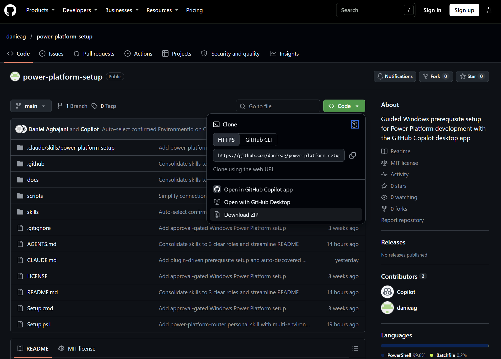

#### 02 — Copilot Desktop App — New Session `+` Menu
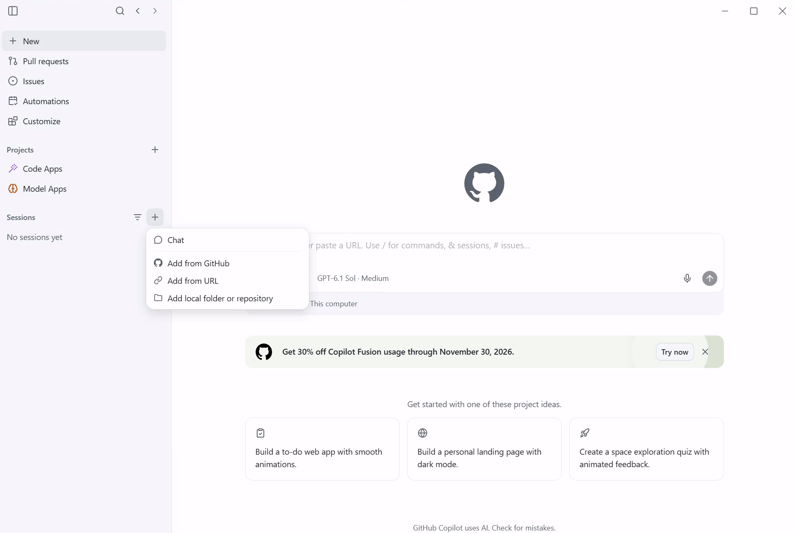

#### 03 — Copilot Desktop App — Search & Add Repository from GitHub
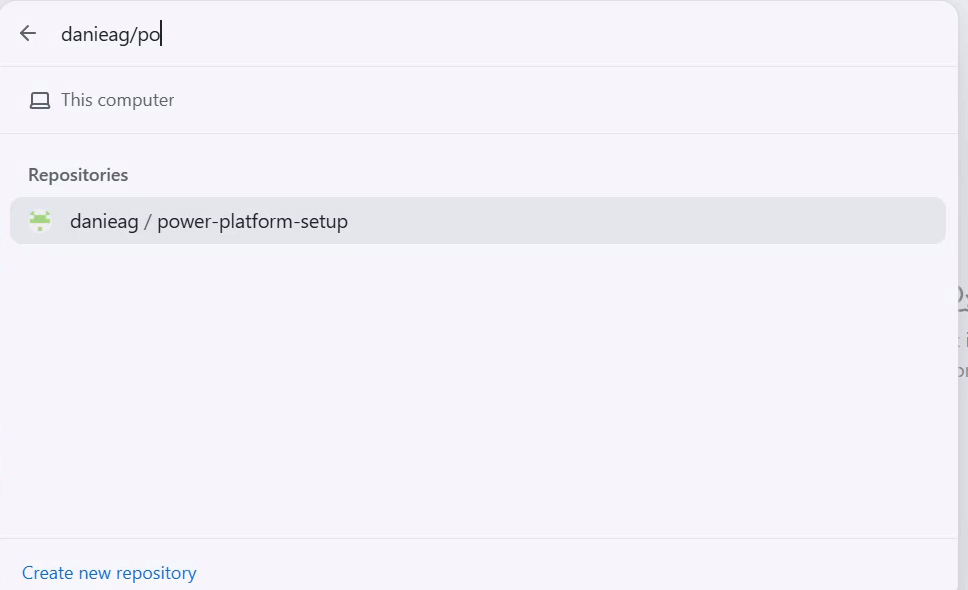

#### 04 — Copilot Desktop App — Paste the One-Prompt Onboarding Request
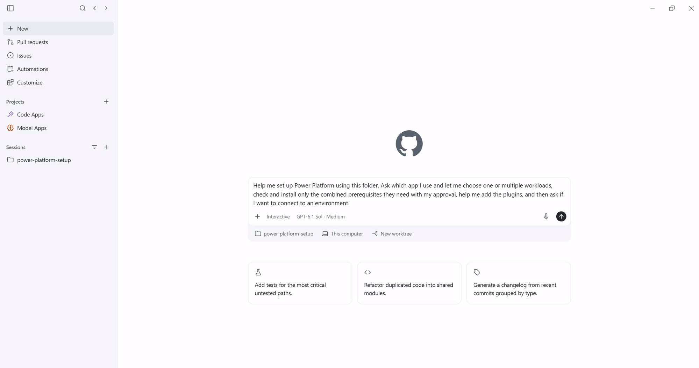

---

### Chapter 2: Choosing App, Multi-Select Workloads & Selective Prerequisites (`05–08`)

| # | Descriptive Name | File | Size | What It Shows |
|---|---|---|---|---|
| 05 | **Workspace Setup Skill Auto-Loaded — Choose Target App** | [`media-bank/05-setup-skill-loaded-choose-target-app.png`](media-bank/05-setup-skill-loaded-choose-target-app.png) | `1262×1296` | `power-platform-setup` loads automatically, reads `SKILL.md`, `AGENTS.md`, `README.md`, and `Setup.ps1`, and asks which app to configure. |
| 06 | **Multi-Workload Picker — Select Multiple Plugins at Once (`1,2,3,5`)** | [`media-bank/06-select-multiple-power-platform-workloads.png`](media-bank/06-select-multiple-power-platform-workloads.png) | `1188×680` | Numbered 1–11 Power Platform catalog where the user enters `1,2,3,5` (Model-driven, Canvas, Code apps, Power Automate) in one reply. |
| 07 | **Selective Prerequisite Plan — Install Only Missing PAC & Azure CLI** | [`media-bank/07-approve-installing-only-missing-pac-and-azure-cli.png`](media-bank/07-approve-installing-only-missing-pac-and-azure-cli.png) | `1172×492` | Preflight detects Git, Node.js/npm, and .NET 10 SDK already ready, asking approval to install **only** the missing PAC CLI and Azure CLI. |
| 08 | **Prerequisites Installed — Approve Marketplace & Selected Plugins** | [`media-bank/08-prerequisites-ready-approve-marketplace-and-plugins.png`](media-bank/08-prerequisites-ready-approve-marketplace-and-plugins.png) | `1184×450` | PAC CLI and Azure CLI installation complete; agent asks separate approval before opening marketplace and plugin prompts one at a time. |

Preview Chapter 2 screenshots (05–08)

#### 05 — Workspace Setup Skill Auto-Loaded — Choose Target App
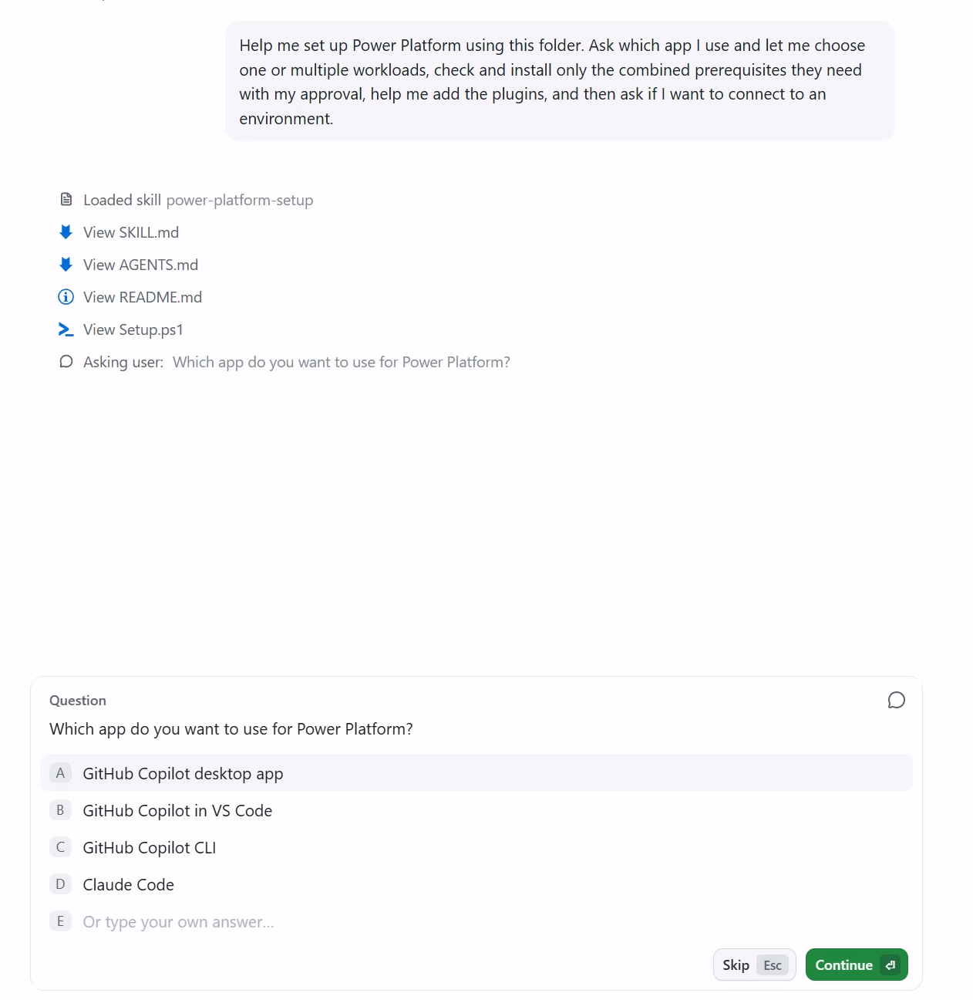

#### 06 — Multi-Workload Picker — Select Multiple Plugins at Once
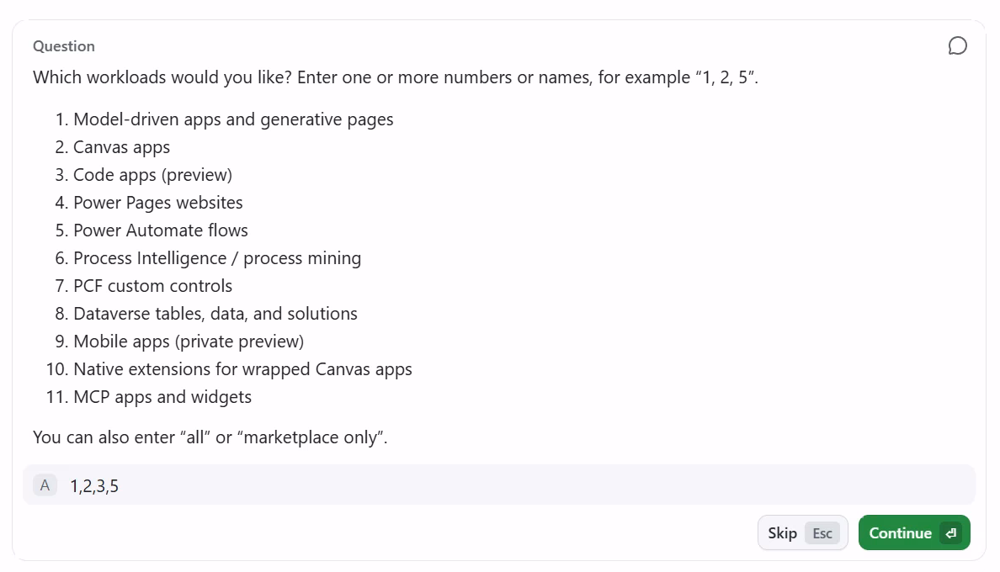

#### 07 — Selective Prerequisite Plan — Install Only Missing PAC & Azure CLI
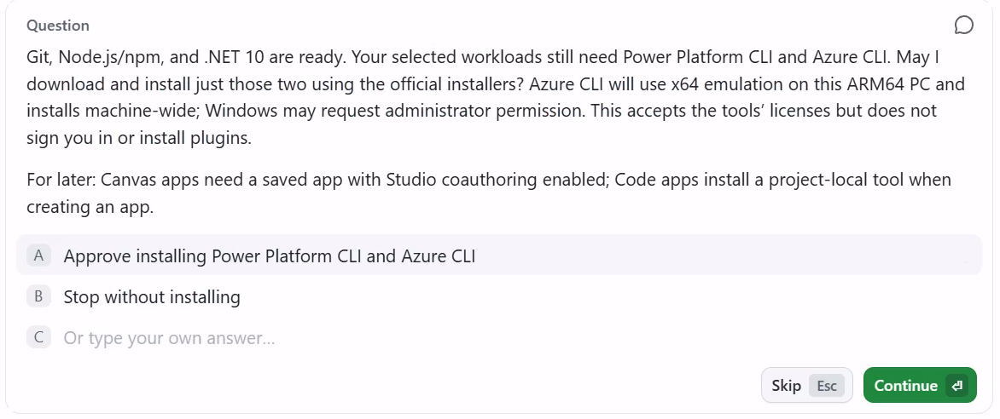

#### 08 — Prerequisites Installed — Approve Marketplace & Selected Plugins
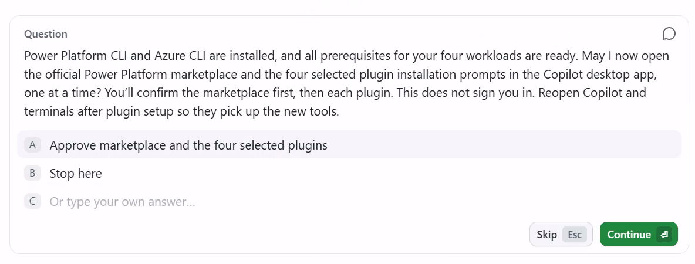

---

### Chapter 3: Marketplace, Step-by-Step Plugins, Personal Skills & Toggling Skills On (`09–16`)

> **Important restart note:** Closing the GitHub Copilot desktop window (`X`) can leave background processes running. Open **Windows Task Manager** (`Ctrl+Shift+Esc`), click **End task** on **GitHub Copilot**, reopen the app, and check **Customize > Installed > Skills** (`#15`) to ensure personal and plugin skills are switched **on**.

| # | Descriptive Name | File | Size | What It Shows |
|---|---|---|---|---|
| 09 | **Copilot App — Allow Official Marketplace Modal + Agent Wait Gate** | [`media-bank/09-copilot-app-allow-marketplace-modal-and-wait-gate.png`](media-bank/09-copilot-app-allow-marketplace-modal-and-wait-gate.png) | `1226×924` | Native `Add plugin marketplace?` dialog (`microsoft/power-platform-skills`) opened via `ghapp://` while the agent waits for confirmation below. |
| 10 | **Copilot App — Install `model-apps` Plugin Modal** | [`media-bank/10-copilot-app-install-model-apps-plugin-modal.png`](media-bank/10-copilot-app-install-model-apps-plugin-modal.png) | `1241×931` | After marketplace confirmation, the agent triggers `model-apps@power-platform-skills` and waits for user confirmation. |
| 11 | **Copilot App — Install `canvas-apps` Plugin Modal** | [`media-bank/11-copilot-app-install-canvas-apps-plugin-modal.png`](media-bank/11-copilot-app-install-canvas-apps-plugin-modal.png) | `1228×930` | Next sequential `ghapp://` modal for `canvas-apps@power-platform-skills` with its corresponding wait prompt. |
| 12 | **All Selected Plugins Confirmed — Offer Guided Environment Connection** | [`media-bank/12-all-selected-plugins-confirmed-offer-connection.png`](media-bank/12-all-selected-plugins-confirmed-offer-connection.png) | `1190×438` | Only after all 4 chosen plugins are confirmed installed does the agent ask whether to guide environment connection setup. |
| 13 | **Approve Installing Personal `power-platform-connect` & `power-platform-router` Skills** | [`media-bank/13-approve-personal-connect-and-router-skills.png`](media-bank/13-approve-personal-connect-and-router-skills.png) | `1169×422` | Approval card explaining and installing both personal helper skills into `~/.copilot/skills/` before reopening Copilot. |
| 14 | **Sequential 4-Plugin Confirmation Log & Reopen Resume Prompt** | [`media-bank/14-four-plugin-confirmation-log-and-reopen-handoff.png`](media-bank/14-four-plugin-confirmation-log-and-reopen-handoff.png) | `1159×1053` | Chat transcript showing one-by-one confirmation of Model-driven, Canvas, Code apps, and Power Automate plugins plus the copyable resume prompt. |
| 15 | **Copilot `Customize > Installed > Skills` — Toggle Personal & Plugin Skills On** | [`media-bank/15-copilot-customize-installed-enable-skills-toggles.png`](media-bank/15-copilot-customize-installed-enable-skills-toggles.png) | `2000×1358` | **Customize > Installed** showing `~/.copilot/skills` (`power-platform-connect`, `power-platform-router`) and plugin skill toggles so users can switch skills **on**. |
| 16 | **Reopen Copilot (End Task in Task Manager if Needed) & Send Resume Prompt** | [`media-bank/16-reopen-copilot-and-paste-connection-resume-prompt.png`](media-bank/16-reopen-copilot-and-paste-connection-resume-prompt.png) | `1215×744` | Sending the PII-free resume prompt after fully closing and reopening the GitHub Copilot desktop app. |

Preview Chapter 3 screenshots (09–16)

#### 09 — Copilot App — Allow Official Marketplace Modal + Agent Wait Gate
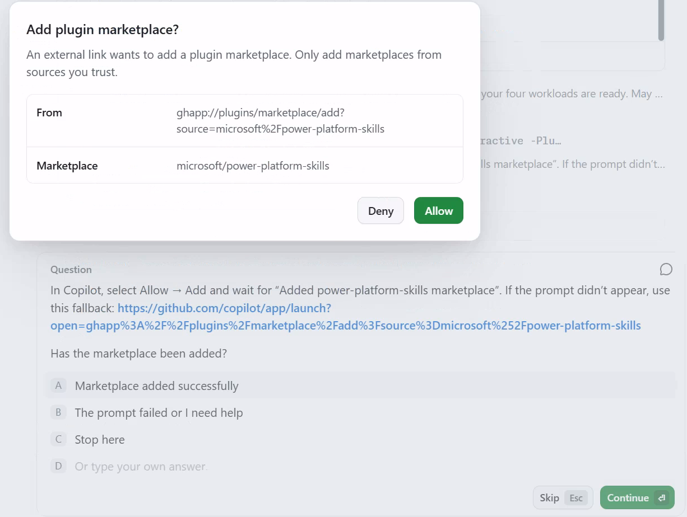

#### 10 — Copilot App — Install `model-apps` Plugin Modal
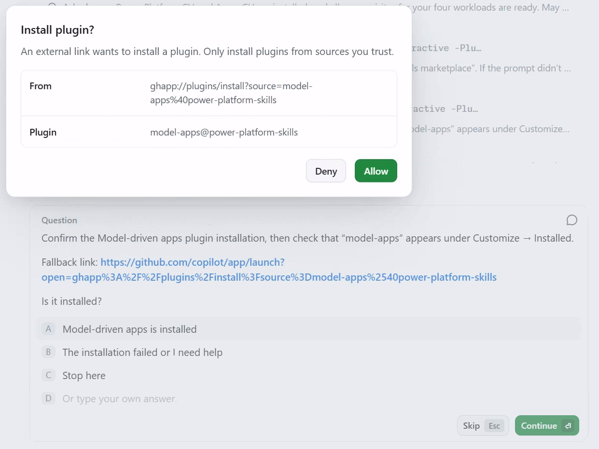

#### 11 — Copilot App — Install `canvas-apps` Plugin Modal
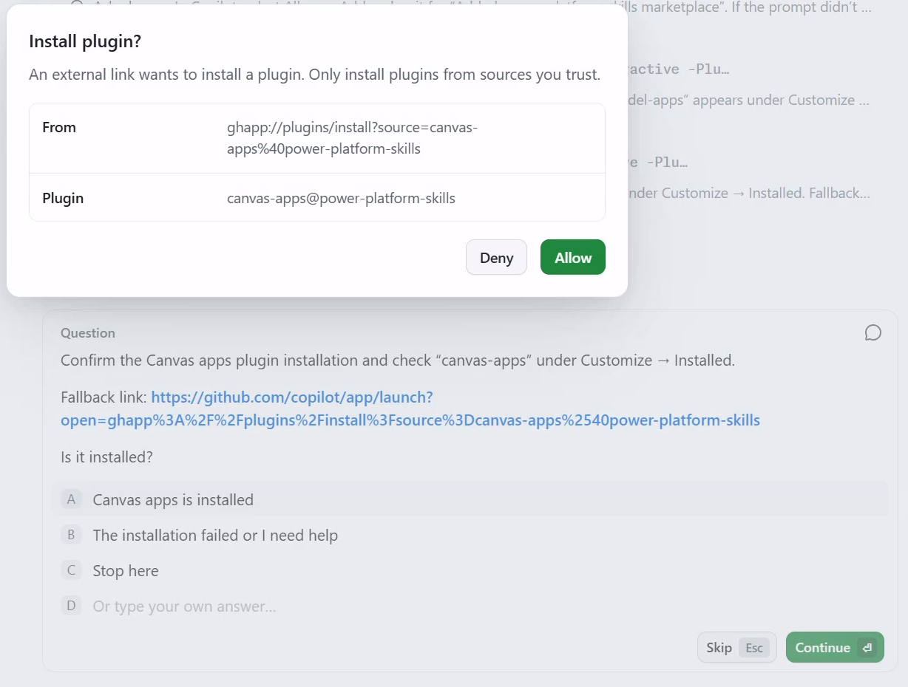

#### 12 — All Selected Plugins Confirmed — Offer Guided Environment Connection
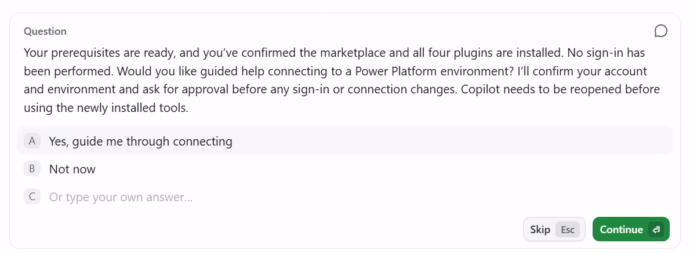

#### 13 — Approve Installing Personal `power-platform-connect` & `power-platform-router` Skills
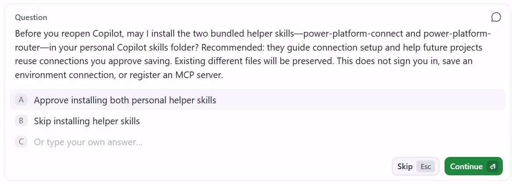

#### 14 — Sequential 4-Plugin Confirmation Log & Reopen Resume Prompt
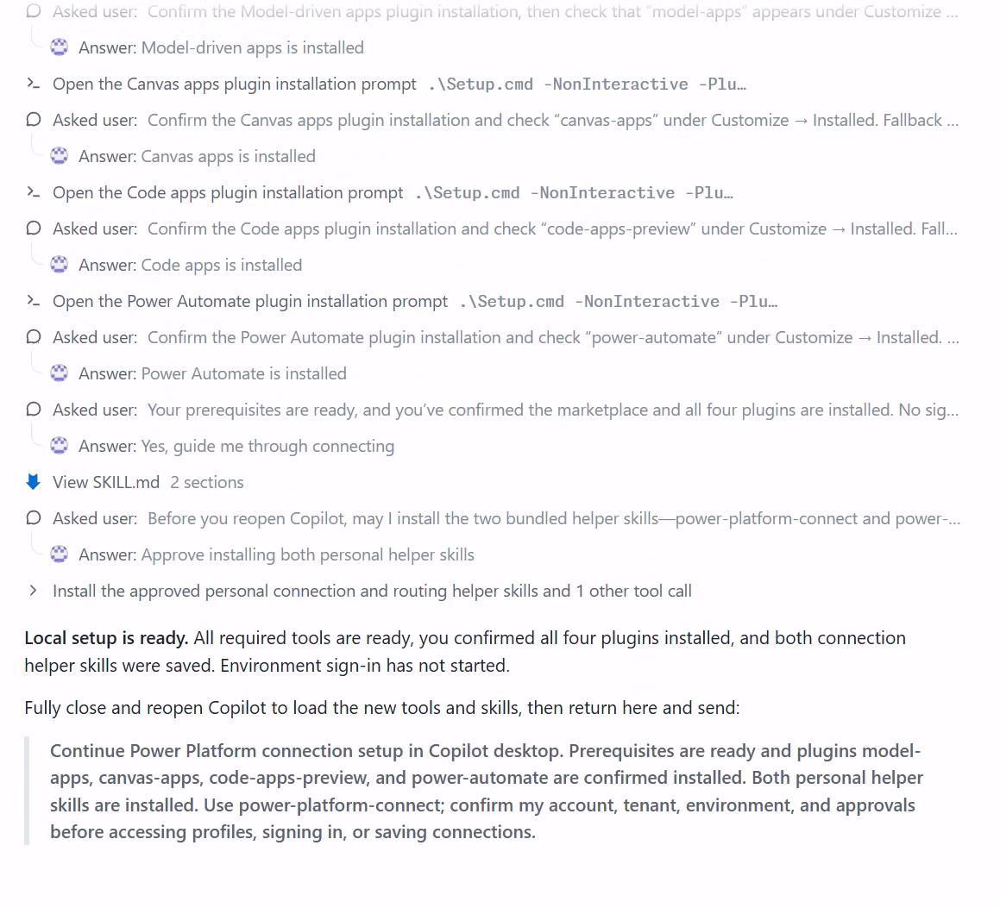

#### 15 — Copilot `Customize > Installed > Skills` — Toggle Personal & Plugin Skills On
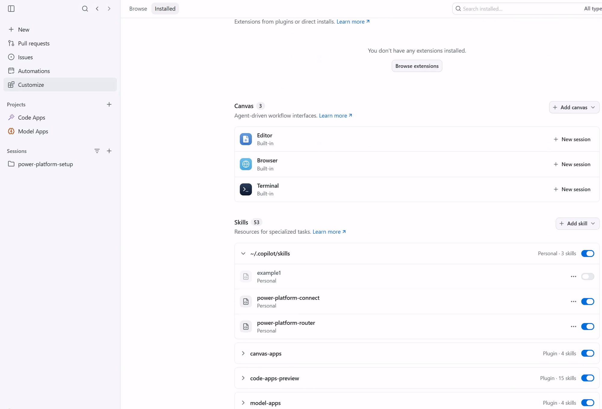

#### 16 — Reopen Copilot & Send Resume Prompt
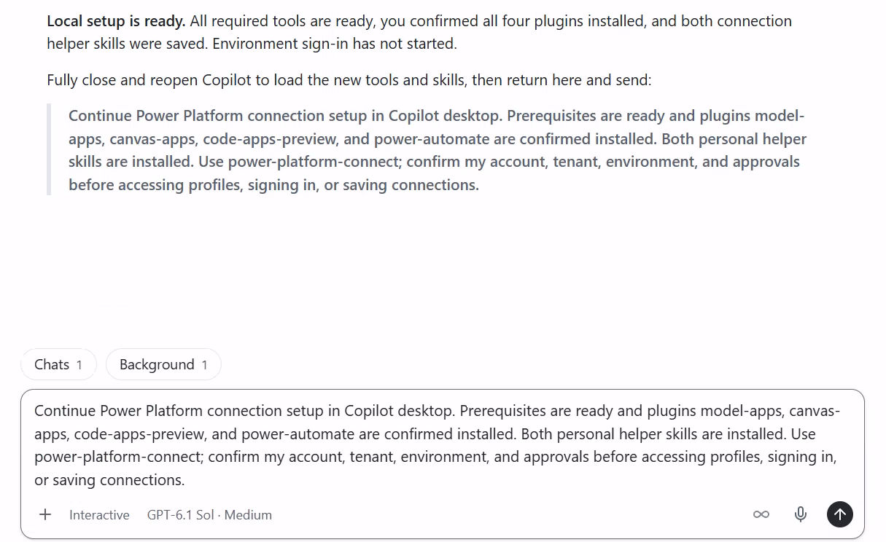

---

### Chapter 4: Connecting PAC, Dataverse Plugin/CLI/MCP, Azure CLI & Saving the Registry Record (`17–33`)

| # | Descriptive Name | File | Size | What It Shows |
|---|---|---|---|---|
| 17 | **Connect Step 1 — Choose Environment Discovery, Saved Connection, or Manual URL** | [`media-bank/17-connect-choose-discovery-saved-or-manual-url.png`](media-bank/17-connect-choose-discovery-saved-or-manual-url.png) | `1174×407` | Entry question offering PAC environment discovery, reusing a saved connection, or entering an existing environment URL. |
| 18 | **Connect Step 2 — Enter Work or School Sign-In Email (UPN)** | [`media-bank/18-connect-enter-work-or-school-signin-email.png`](media-bank/18-connect-enter-work-or-school-signin-email.png) | `1182×306` | Plain-language prompt asking for the user's Microsoft Entra sign-in username with a fictional example (`alex@example.com`). |
| 19 | **Connect Step 3 — Enter Microsoft Entra Tenant ID (with Navigation Path)** | [`media-bank/19-connect-enter-microsoft-entra-tenant-id.png`](media-bank/19-connect-enter-microsoft-entra-tenant-id.png) | `1166×382` | Prompt explaining where to find **Tenant ID** in Microsoft Entra admin center and distinguishing it from Subscription/Environment/Org IDs. |
| 20 | **Connect Step 4 — Approve Read-Only Local PAC & Registry Metadata Check** | [`media-bank/20-connect-approve-local-pac-and-registry-inspection.png`](media-bank/20-connect-approve-local-pac-and-registry-inspection.png) | `1175×443` | Permission card before inspecting local `pac auth list` profiles and saved connection bindings (account & Tenant ID redacted). |
| 21 | **Connect Step 5 — Enter Initial Environment URL for PAC Sign-In** | [`media-bank/21-connect-enter-initial-environment-url-context.png`](media-bank/21-connect-enter-initial-environment-url-context.png) | `1181×430` | When no local PAC profile exists yet, prompt asking for one existing Dataverse URL (`https://yourorg.crm4.dynamics.com`) with PPAC instructions. |
| 22 | **Connect Step 6 — Confirm Account, Tenant & Environment Before PAC Sign-In** | [`media-bank/22-connect-approve-pac-profile-and-device-code-signin.png`](media-bank/22-connect-approve-pac-profile-and-device-code-signin.png) | `1191×602` | Explicit confirmation of account, Tenant ID, and environment URL (all redacted) before running `pac auth create`. |
| 23 | **Connect Step 7 — PAC Device-Code Output & Sign-In Confirmation** | [`media-bank/23-connect-pac-device-code-output-and-signin-confirm.png`](media-bank/23-connect-pac-device-code-output-and-signin-confirm.png) | `1188×1052` | Running `pac auth create --deviceCode` showing the terminal code output above and confirmation question below *(updated skill now puts **`**CODE**`** + `[Sign in to your account](https://login.microsoftonline.com/common/oauth2/deviceauth)` directly in the question)*. |
| 24 | **Connect Step 8 — PAC Signed In: Offer Live Discovery (`pac env list`) or Direct URL** | [`media-bank/24-connect-pac-signed-in-offer-environment-discovery.png`](media-bank/24-connect-pac-signed-in-offer-environment-discovery.png) | `1198×550` | PAC sign-in verified; user can run read-only `pac env list` discovery across their tenant or proceed directly with the supplied URL. |
| 25 | **Connect Step 9 — Select Tools to Connect & Option to Add Dataverse Plugin** | [`media-bank/25-connect-select-surfaces-and-optional-dataverse-plugin.png`](media-bank/25-connect-select-surfaces-and-optional-dataverse-plugin.png) | `1190×582` | Capability-gated picker offering PAC + Azure CLI, PAC only, or adding the `dataverse` plugin first to enable Dataverse CLI & MCP. |
| 26 | **Connect Step 10 — Dataverse CLI Detected (`1.0.88`): Propose Connection Nickname** | [`media-bank/26-connect-dataverse-cli-detected-propose-nickname.png`](media-bank/26-connect-dataverse-cli-detected-propose-nickname.png) | `1189×425` | Reuses existing global `@microsoft/dataverse` installation without reinstalling and asks whether to use the suggested nickname or pick another. |
| 27 | **Connect Step 11 — Choose Custom Connection Nickname (`demo-env`)** | [`media-bank/27-connect-enter-custom-demo-env-nickname.png`](media-bank/27-connect-enter-custom-demo-env-nickname.png) | `1170×306` | Entering `demo-env` as the local registry alias. |
| 28 | **Connect Step 12 — Approve Registering `dataverse-demo-env` in `mcp-config.json`** | [`media-bank/28-connect-approve-dataverse-mcp-config-entry.png`](media-bank/28-connect-approve-dataverse-mcp-config-entry.png) | `1173×705` | Shows exact `node.exe` + `dataverse.js mcp <environment-url>` stdio definition before saving to `.copilot\mcp-config.json`. |
| 29 | **Connect Step 13 — Approve Saving Private `connections\demo-env.json` Record** | [`media-bank/29-connect-approve-saving-private-demo-env-json.png`](media-bank/29-connect-approve-saving-private-demo-env-json.png) | `1207×507` | Confirmation card before writing the token-free `demo-env.json` binding record under `%LOCALAPPDATA%\PowerPlatformSetup\connections\`. |
| 30 | **Connect Step 14 — Approve Fresh-Process PAC, Dataverse CLI & Azure Token Check** | [`media-bank/30-connect-approve-fresh-process-cli-and-azure-checks.png`](media-bank/30-connect-approve-fresh-process-cli-and-azure-checks.png) | `1177×489` | Bounded read-only verification in a fresh process (checking Azure token expiry timestamp without printing any token). |
| 31 | **Connect Step 15 — Fresh-Process CLI Checks Passed: Approve Post-Reload MCP Check** | [`media-bank/31-connect-cli-checks-passed-approve-mcp-verify-after-reload.png`](media-bank/31-connect-cli-checks-passed-approve-mcp-verify-after-reload.png) | `1181×480` | Confirms PAC, Dataverse CLI, and Azure CLI all passed in a fresh process and asks permission for post-reload MCP verification. |
| 32 | **Connect Step 16 — Pre-Reload Handoff Prompt for Dataverse MCP** | [`media-bank/32-connect-saved-reopen-copilot-for-mcp-verification.png`](media-bank/32-connect-saved-reopen-copilot-for-mcp-verification.png) | `1139×252` | Short resume prompt instructing the user to fully close and reopen Copilot so `dataverse-demo-env` loads. |
| 33 | **Connect Step 17 — Post-Reload Dataverse MCP Live Identity Verified** | [`media-bank/33-connect-post-reload-dataverse-mcp-verified.png`](media-bank/33-connect-post-reload-dataverse-mcp-verified.png) | `1148×466` | After reopening Copilot, `dataverse-demo-env` returns the matching organization ID with zero new sign-in prompts. |

Preview Chapter 4 screenshots (17–33)

#### 17 — Choose Environment Discovery, Saved Connection, or Manual URL
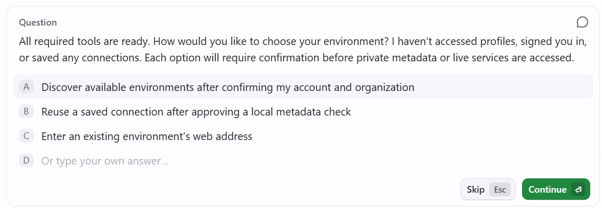

#### 18 — Enter Work or School Sign-In Email (UPN)
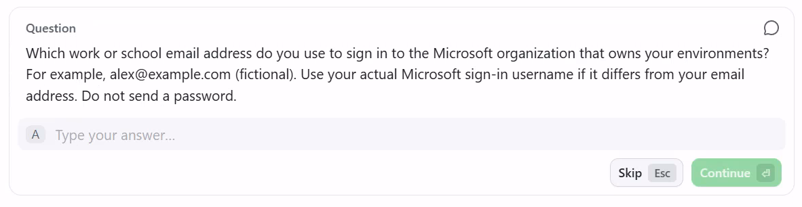

#### 19 — Enter Microsoft Entra Tenant ID
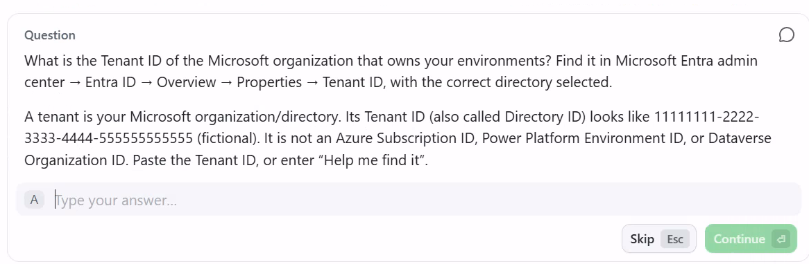

#### 20 — Approve Read-Only Local PAC & Registry Metadata Check
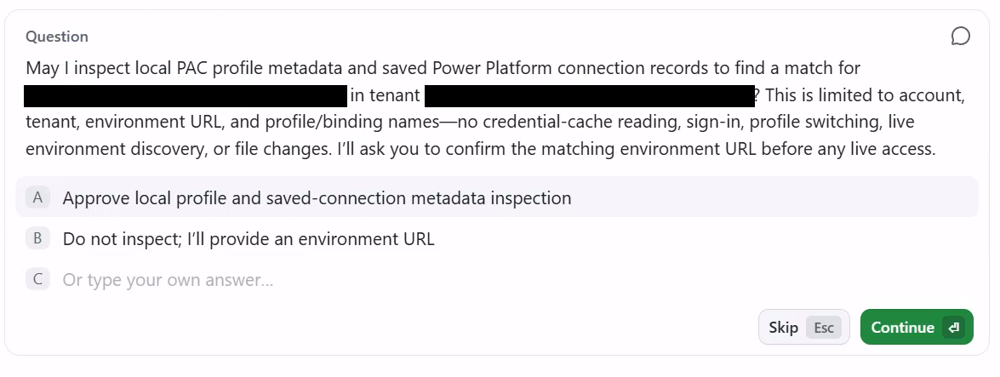

#### 21 — Enter Initial Environment URL for PAC Sign-In
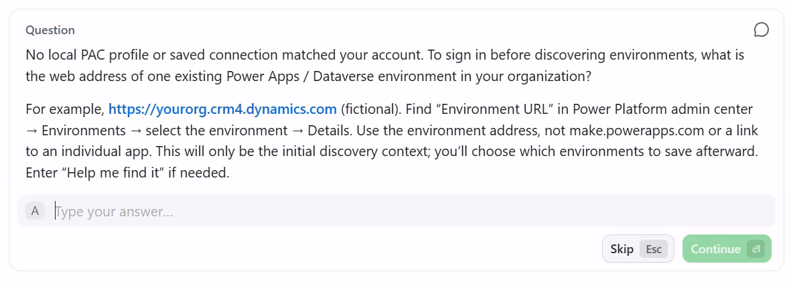

#### 22 — Confirm Account, Tenant & Environment Before PAC Sign-In
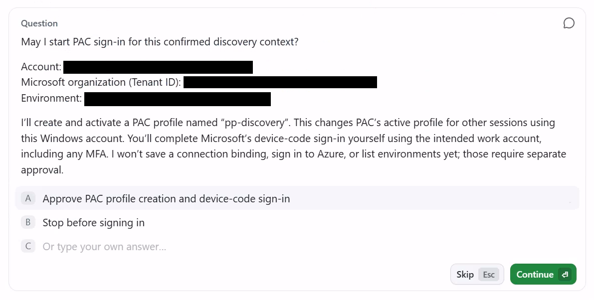

#### 23 — PAC Device-Code Output & Sign-In Confirmation
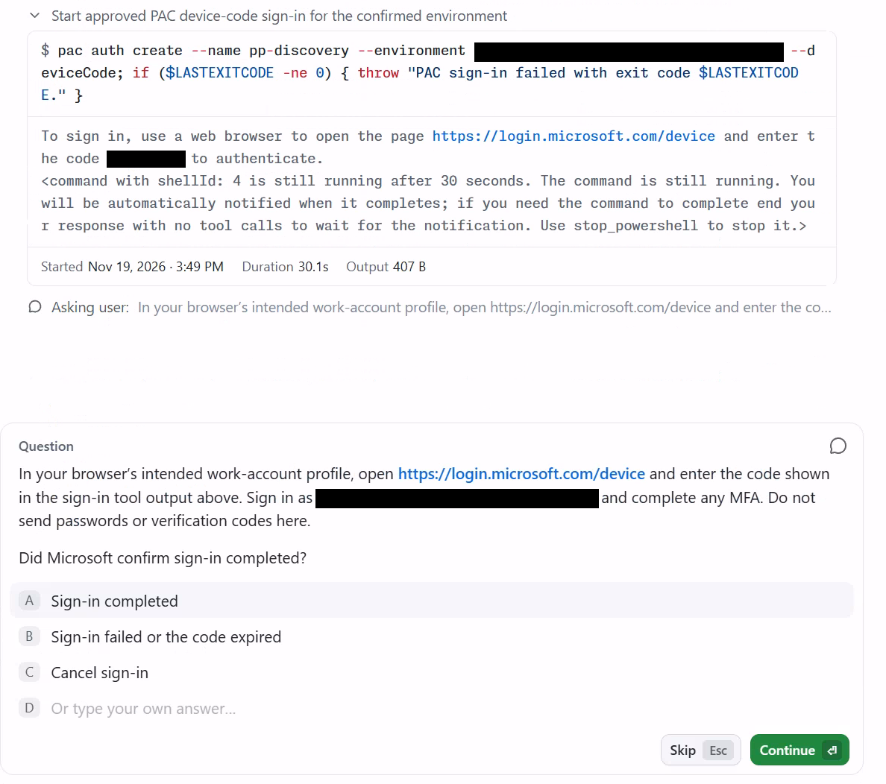

#### 24 — PAC Signed In: Offer Live Discovery (`pac env list`) or Direct URL
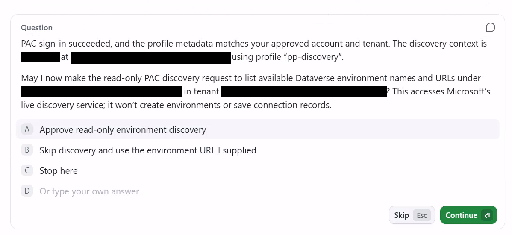

#### 25 — Select Tools to Connect & Option to Add Dataverse Plugin
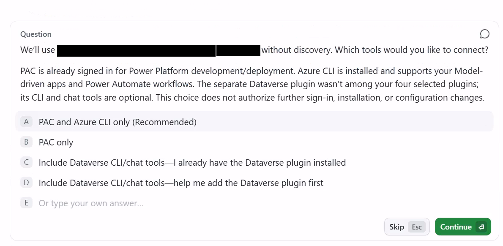

#### 26 — Dataverse CLI Detected: Propose Connection Nickname
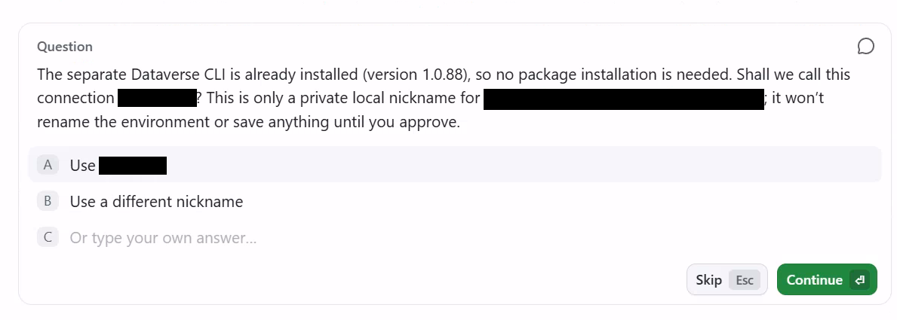

#### 27 — Choose Custom Connection Nickname (`demo-env`)
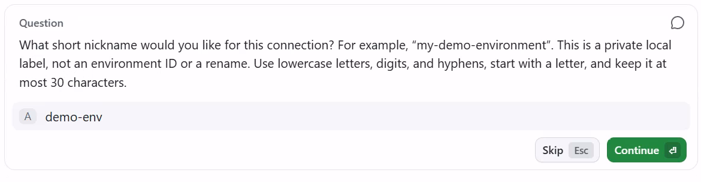

#### 28 — Approve Registering `dataverse-demo-env` in `mcp-config.json`
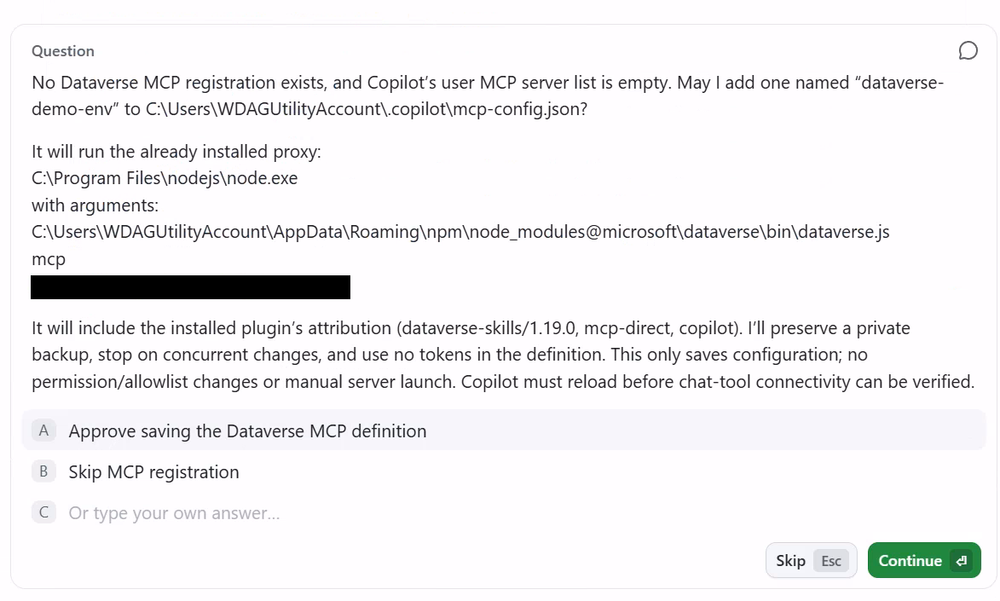

#### 29 — Approve Saving Private `connections\demo-env.json` Record
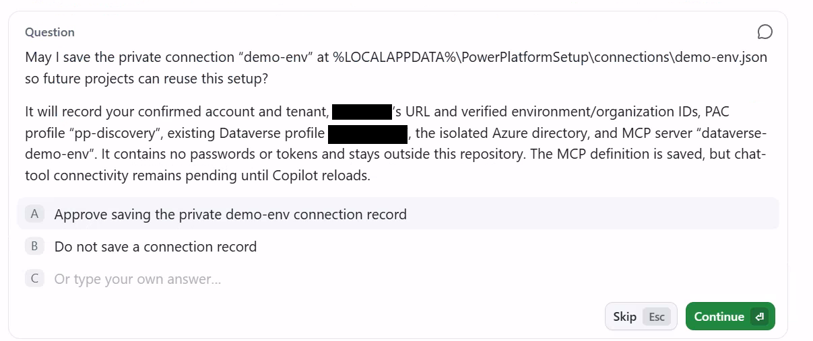

#### 30 — Approve Fresh-Process PAC, Dataverse CLI & Azure Token Check
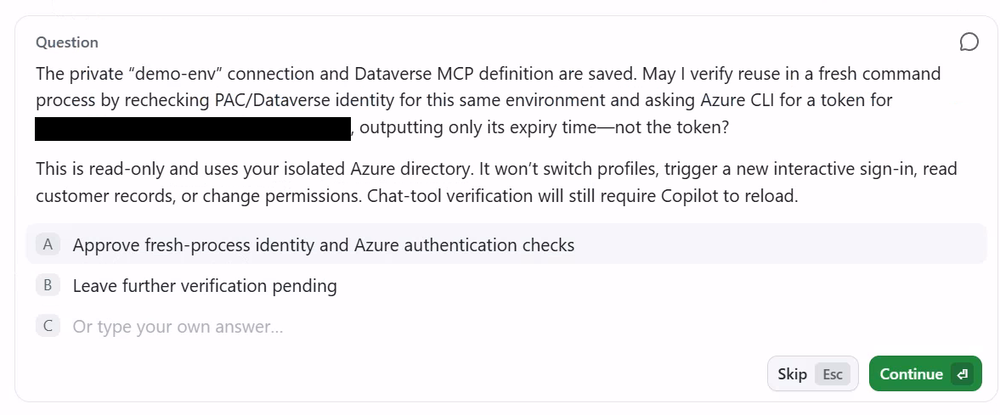

#### 31 — Fresh-Process CLI Checks Passed: Approve Post-Reload MCP Check
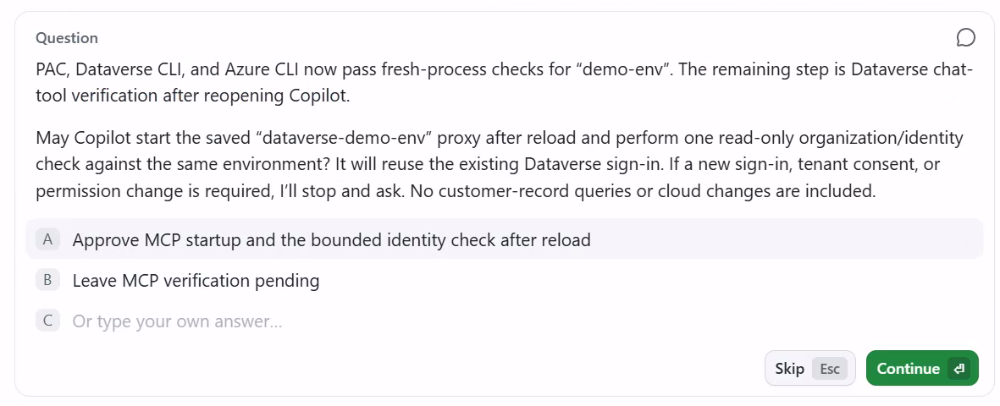

#### 32 — Pre-Reload Handoff Prompt for Dataverse MCP
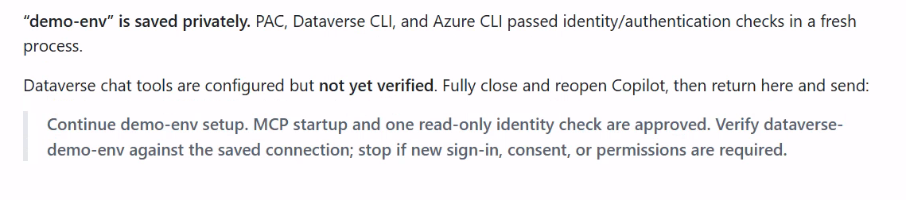

#### 33 — Post-Reload Dataverse MCP Live Identity Verified
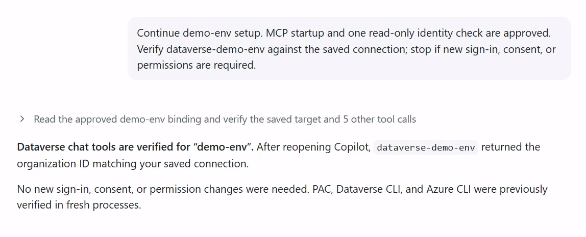

---

### Chapter 5: Linking FlowAgent MCP & Copilot Studio MCP to the Registry (`34–40`)

> **Intended FlowAgent workflow:** Set up Power Automate (`flowagent`) in the normal way first (`#34`); once visible, `power-platform-connect` / `power-platform-router` checks `whoami` (`#35–#36`) and asks to link `"flowagent": "flowagent"` into `<alias>.json`'s `mcpServers` map (`#37`).

| # | Descriptive Name | File | Size | What It Shows |
|---|---|---|---|---|
| 34 | **FlowAgent Step 1 — Install Power Automate Plugin in the Normal Way** | [`media-bank/34-flowagent-install-power-automate-plugin-normally.png`](media-bank/34-flowagent-install-power-automate-plugin-normally.png) | `1151×721` | Checking prerequisites and opening the `power-automate` plugin install modal in the Copilot app. |
| 35 | **FlowAgent Step 2 — `flowagent` MCP Visible (~60 Tools): Approve `whoami` Check** | [`media-bank/35-flowagent-mcp-detected-approve-readonly-whoami-check.png`](media-bank/35-flowagent-mcp-detected-approve-readonly-whoami-check.png) | `1188×905` | Agent detects `flowagent` MCP and asks approval for read-only `whoami` and `get_current_env` before linking it to the registry. |
| 36 | **FlowAgent Step 3 — Identity Matched to Saved Azure Profile: Offer Registry Link** | [`media-bank/36-flowagent-identity-matched-offer-registry-link.png`](media-bank/36-flowagent-identity-matched-offer-registry-link.png) | `1136×1076` | `flowagent` reuses the Azure CLI login matching the saved account/tenant; agent asks to add `"flowagent": "flowagent"` to `mcpServers`. |
| 37 | **FlowAgent Step 4 — Saved `"flowagent"` into Connection Registry JSON** | [`media-bank/37-flowagent-linked-in-connection-registry-json.png`](media-bank/37-flowagent-linked-in-connection-registry-json.png) | `1126×390` | Confirmation that `mcpServers` now maps both `"dataverse"` and `"flowagent"`, with active environment set per session at runtime. |
| 38 | **Copilot Studio MCP Step 1 — Approve Registration via External PowerShell While Closed** | [`media-bank/38-copilot-studio-mcp-approve-registration-while-closed.png`](media-bank/38-copilot-studio-mcp-approve-registration-while-closed.png) | `1180×484` | Safely registering `npx -y @microsoft/copilot-studio-mcp@latest` while Copilot is closed so `mcp-config.json` is never overwritten concurrently. |
| 39 | **Copilot Studio MCP Step 2 — Verified Signed-In Status & Auto-Offer Registry Link** | [`media-bank/39-copilot-studio-mcp-verified-offer-registry-link.png`](media-bank/39-copilot-studio-mcp-verified-offer-registry-link.png) | `1193×1220` | After reopening, `copilot_studio_status` confirms persisted credentials matching `demo-env` and offers to add `"copilotStudio": "copilot-studio"`. |
| 40 | **Copilot Studio MCP Step 3 — Linked in `demo-env.json` Summary** | [`media-bank/40-copilot-studio-mcp-linked-in-registry-summary.png`](media-bank/40-copilot-studio-mcp-linked-in-registry-summary.png) | `1082×157` | Confirmation that `demo-env.json` now maps Copilot Studio MCP alongside Dataverse with persisted credentials. |

Preview Chapter 5 screenshots (34–40)

#### 34 — FlowAgent Step 1 — Install Power Automate Plugin in the Normal Way
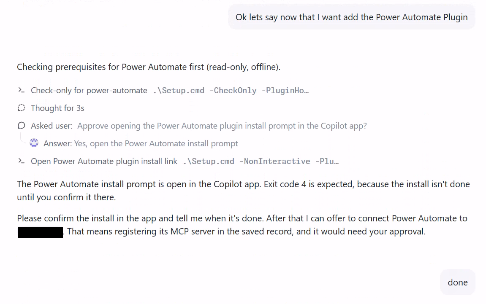

#### 35 — FlowAgent Step 2 — `flowagent` MCP Visible: Approve `whoami` Check
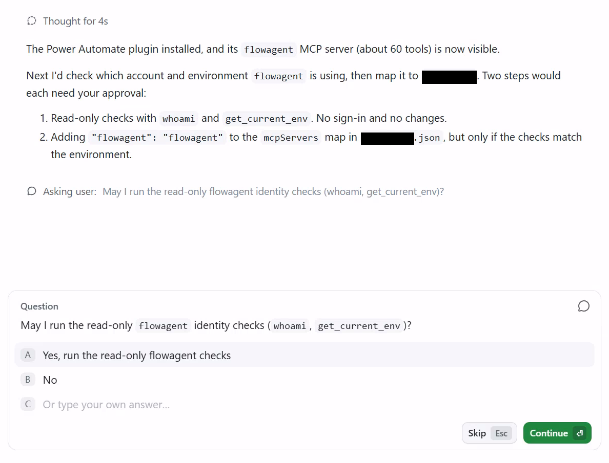

#### 36 — FlowAgent Step 3 — Identity Matched: Offer Registry Link
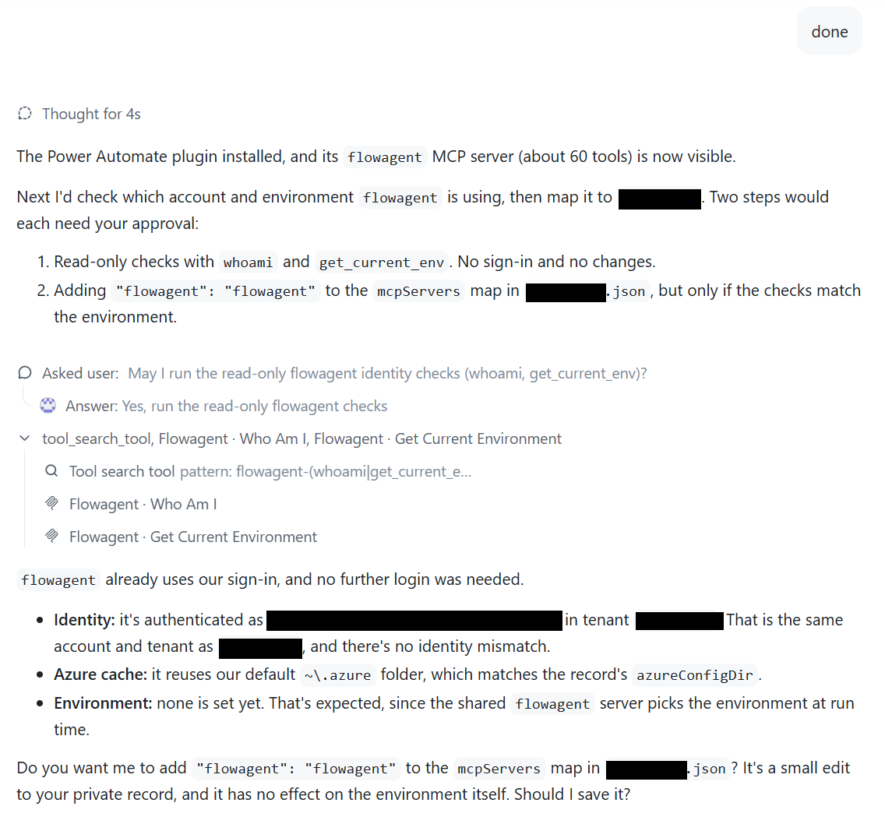

#### 37 — FlowAgent Step 4 — Saved `"flowagent"` into Connection Registry JSON
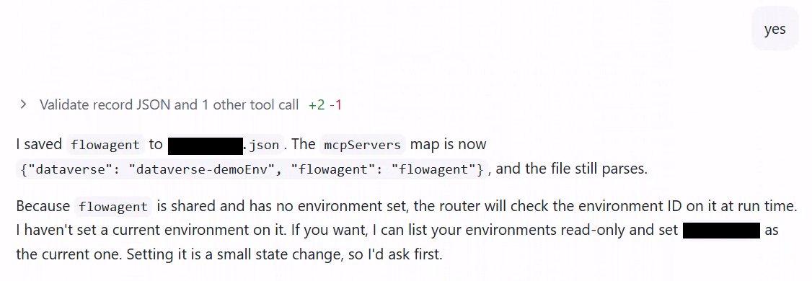

#### 38 — Copilot Studio MCP Step 1 — Approve Registration While Closed
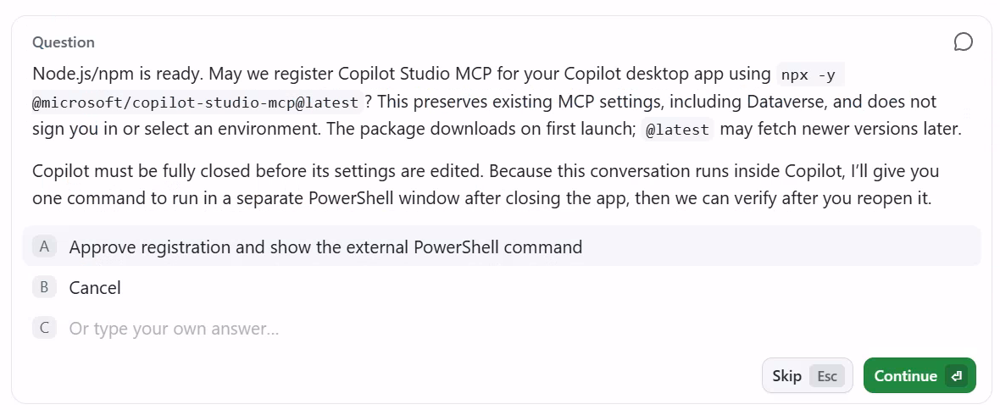

#### 39 — Copilot Studio MCP Step 2 — Verified Status & Auto-Offer Registry Link
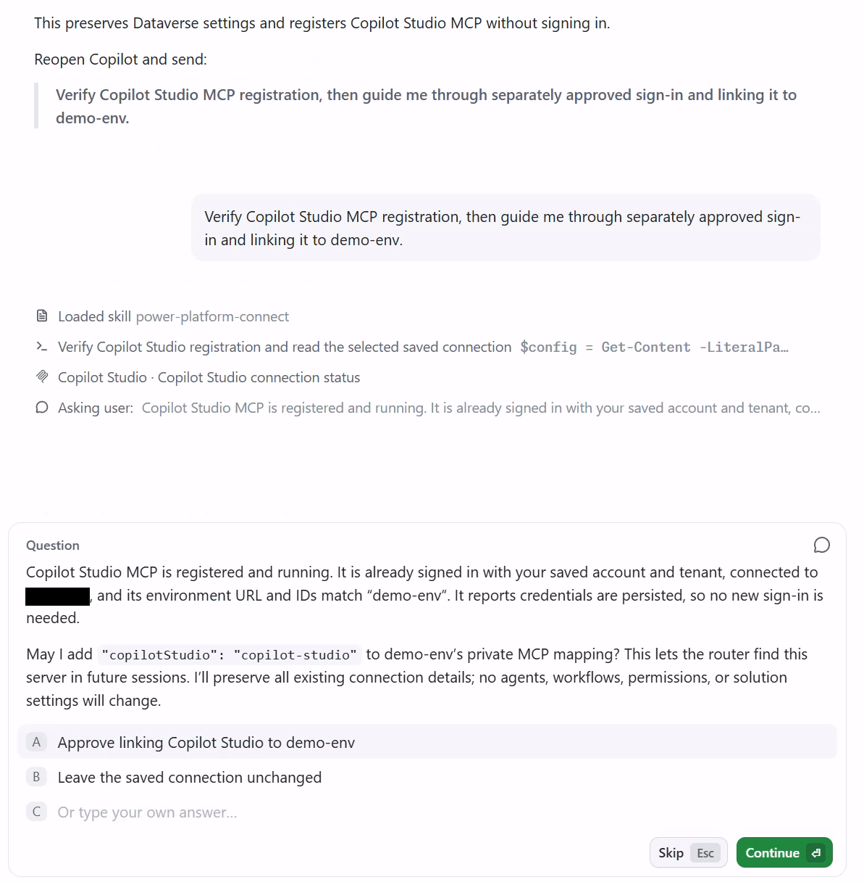

#### 40 — Copilot Studio MCP Step 3 — Linked in `demo-env.json` Summary
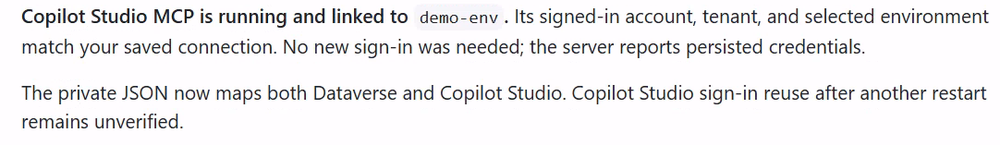

---

### Chapter 6: Final End-to-End Verification with `power-platform-router` (`41`)

| # | Descriptive Name | File | Size | What It Shows |
|---|---|---|---|---|
| 41 | **`power-platform-router` — All 6 CLIs & MCPs Verified Against `demo-env`** | [`media-bank/41-router-skill-all-six-clis-and-mcps-verified.png`](media-bank/41-router-skill-all-six-clis-and-mcps-verified.png) | `1168×1115` | Loading `power-platform-router` from `%LOCALAPPDATA%\PowerPlatformSetup\connections\demo-env.json` and verifying live access across **Dataverse MCP**, **Dataverse CLI**, **PAC CLI**, **Azure CLI**, **Flow Agent MCP**, and **Copilot Studio MCP** in one table. |

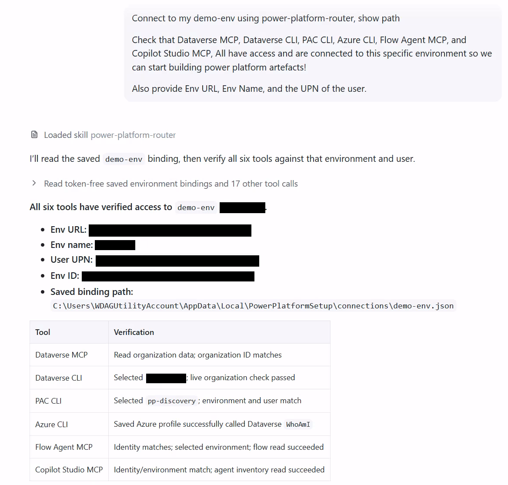

---

## Part 2 — Supplemental Reference Screenshots (`docs/images/`)

These additional screenshots in `docs/images/` cover alternative entry paths (double-clicking `Setup.cmd`, VS Code's native marketplace UI, Microsoft Entra browser device-code screens, and Dataverse MCP's 18-tool readout):

| Category | File | Descriptive Summary |
|---|---|---|
| **Console `Setup.cmd` (Option B)** | [`images/01-download-zip.png`](images/01-download-zip.png) | GitHub **Code > Download ZIP** menu cropped close-up. |
| **Console `Setup.cmd` (Option B)** | [`images/02-extracted-folder.png`](images/02-extracted-folder.png) | Windows File Explorer showing extracted `Setup`, `Setup.ps1`, and `skills`. |
| **Console `Setup.cmd` (Option B)** | [`images/03-open-setup.png`](images/03-open-setup.png) | Right-clicking `Setup.cmd` and choosing **Open** as a normal Windows user. |
| **Console `Setup.cmd` (Option B)** | [`images/04-approve-install.png`](images/04-approve-install.png) | Console preflight readiness check and typing `INSTALL` to approve missing prerequisites. |
| **Console `Setup.cmd` (Option B)** | [`images/05-dotnet-download.png`](images/05-dotnet-download.png) | PowerShell downloading the native ARM64 .NET 10 SDK installer. |
| **Console `Setup.cmd` (Option B)** | [`images/06-dotnet-error.png`](images/06-dotnet-error.png) | Example file-lock error (`exit code: 3`) recovery scenario. |
| **Console `Setup.cmd` (Option B)** | [`images/07-dotnet-ready.png`](images/07-dotnet-ready.png) | Follow-up `-CheckOnly` run showing `.NET SDK` `[READY]`. |
| **Console `Setup.cmd` (Option B)** | [`images/08-approve-plugins.png`](images/08-approve-plugins.png) | Console host chooser (option `3` Copilot desktop), Dataverse opt-in, and `PLUGINS` prompt. |
| **Copilot Attach Menu** | [`images/09-add-local-folder.png`](images/09-add-local-folder.png) | Cropped `+ > Add local folder or repository` menu item. |
| **VS Code Native Marketplace** | [`images/11-vscode-configure-marketplaces.png`](images/11-vscode-configure-marketplaces.png) | VS Code **Customizations > Browse > All Sources > Configure Marketplaces**. |
| **VS Code Native Marketplace** | [`images/12-vscode-add-marketplace.png`](images/12-vscode-add-marketplace.png) | VS Code **Add Marketplace...** button. |
| **VS Code Native Marketplace** | [`images/13-vscode-marketplace-source.png`](images/13-vscode-marketplace-source.png) | Entering `microsoft/power-platform-skills` in VS Code. |
| **VS Code Native Marketplace** | [`images/14-vscode-plugin-catalog.png`](images/14-vscode-plugin-catalog.png) | Browsing and installing individual Power Platform plugins in VS Code. |
| **VS Code Connect Walkthrough** | [`images/15-connect-start.png`](images/15-connect-start.png) – [`images/28-connect-after-restart.png`](images/28-connect-after-restart.png) | 14-step redacted VS Code `power-platform-connect` run (used in [`power-platform-connect-guide.md`](power-platform-connect-guide.md)). |
| **Copilot App Walkthrough (Earlier Run)** | [`images/31-agent-short-prompt.png`](images/31-agent-short-prompt.png) – [`images/45-copilot-app-install-code-apps.png`](images/45-copilot-app-install-code-apps.png) | Step-by-step `Manage marketplaces` progress modals (`Adding marketplace...` -> `✓ Added power-platform-skills marketplace`), returning to the **Sessions** sidebar (`40`), and `Install plugin` modals (`42–45`). |
| **Browser Device-Code Screens** | [`images/51-connect-enter-device-code.png`](images/51-connect-enter-device-code.png) | Microsoft browser page (`Enter code to allow access`) where the user pastes the one-time device code. |
| **Browser Device-Code Screens** | [`images/52-connect-approve-signin.png`](images/52-connect-approve-signin.png) | Microsoft Entra prompt (`You're signing in to Power Platform CLI - pac`) with redacted account. |
| **Browser Device-Code Screens** | [`images/53-connect-pac-signed-in-browser.png`](images/53-connect-pac-signed-in-browser.png) | Browser confirmation (`You have signed in to the Power Platform CLI - pac application on your device`). |
| **Dataverse MCP Live Tools** | [`images/61-connect-mcp-server-customize-installed.png`](images/61-connect-mcp-server-customize-installed.png) | Copilot **Customize > Installed > MCP Servers** showing the enabled custom Dataverse MCP server. |
| **Dataverse MCP Live Tools** | [`images/62-connect-mcp-live-verify-tools.png`](images/62-connect-mcp-live-verify-tools.png) | Live read-only Dataverse MCP check listing all 18 exposed Dataverse MCP tools. |
| **Persistence Summary Cards** | [`images/63-connect-all-surfaces-summary.png`](images/63-connect-all-surfaces-summary.png), [`images/64-connect-persistence-verified.png`](images/64-connect-persistence-verified.png) | Multi-surface verification table and post-restart persistence confirmation. |
