# Power Platform Connect: illustrated walkthrough

The **power-platform-connect** skill guides your agent through connecting the
tools you choose to an existing Power Platform environment. It asks for the
target first, checks what is installed, and separates software installation,
sign-in, local configuration, and live verification.

These are cropped, permanently redacted **original screenshots from a
user-reported Windows Sandbox session using Copilot in VS Code**. Black areas
hide identifying connection details and private paths. Remaining addresses,
email addresses, and IDs explicitly labeled as examples are fictional.
Prompts, supported locations, and menus can differ by app, agent harness, or
version. The screenshots illustrate this run, not a universal configuration
recipe or a guarantee of lasting authentication.

## Before you start

Finish the [Windows prerequisite setup](../README.md) and install the
Dataverse plugin in your chosen app. Confirm that **power-platform-connect**
appears in the app's skills list, then start a fresh agent chat.

Using the README's full guided setup prompt instead? Its entry skill reads the
bundled connection instructions for you and continues the same flow when the
required capabilities are available. The fresh-chat start below illustrates
the standalone route; PATH changes or MCP discovery still require a real
restart/reload when applicable.

**Start with power-platform-connect, not a separate dv-connect run.**
Microsoft's `dv-connect` is an end-to-end onboarding workflow, not just a
Dataverse CLI installer; it can proceed to authentication and configuration.
The custom skill reads `dv-overview` and `dv-connect` and reuses their supported
mechanisms only within your approved scope. You do not need to complete
`dv-connect` beforehand.

Skills are instructions for an agent, not a technical security boundary.
Keep normal interactive approvals enabled, review each proposed operation,
and do not enable blanket auto-approval to follow this guide. A screenshot's
Yes button is not a recommendation to approve a different plan.

## 1. Start the skill and identify your app

Select `/power-platform-connect` if it appears in the chat's slash-command
menu, or ask:

> Use the power-platform-connect skill to help me set up my connections.
> First confirm my app, intended account, tenant, environment, and tools.
> Check local prerequisites and explain the plan. Ask before installing
> software, signing in, switching profiles, saving configuration, starting
> MCP servers, or making live requests. Do not change tenant permissions
> or create cloud resources.

Choose the app you actually use. **Copilot in VS Code is not the Copilot desktop
app or Copilot CLI.** Say "GitHub Copilot Chat in VS Code" explicitly if needed;
do not select another app just because it is the default or the only suggested
choice. The highlighted desktop option below is an initial prompt state,
not the host to choose for VS Code.

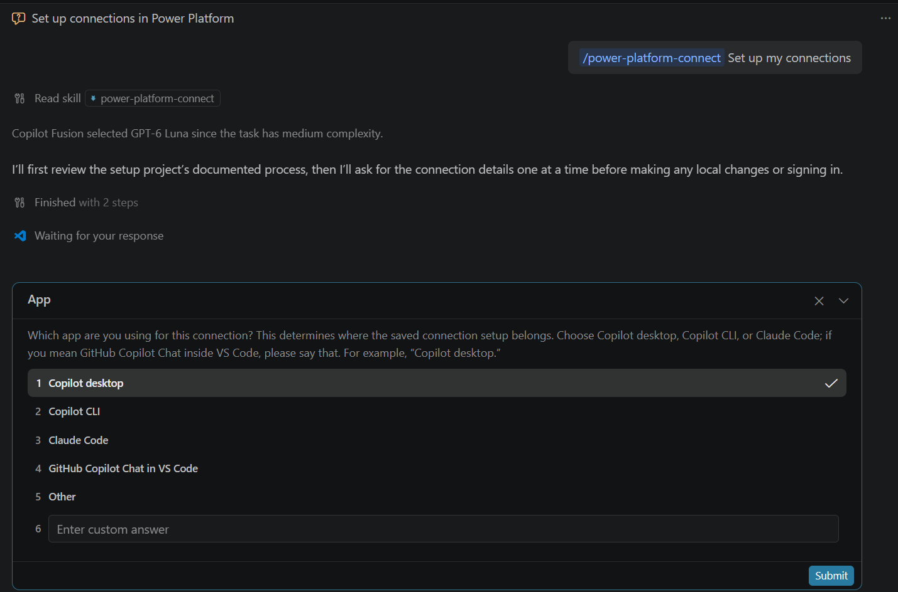

### Discover and select environments, or enter a URL

The current skill's default route is **PAC sign-in/reuse > `pac env list` >
environment names and URLs > choose one or more > set up those connections**.
The screenshots below show the original single-target **manual URL** branch;
they are not screenshots of the newer discovery/multi-select prompts.

The agent first confirms the account, tenant and exact existing PAC environment
context and asks before profile selection, sign-in or the live discovery read.
If there is no suitable authenticated profile, it asks for one known environment
URL for that initial PAC sign-in, then returns to discovery. A valid matching
session does not require signing in again just to populate the list.

Choose one or several returned environments by name and exact URL. You can
always choose **Enter another existing environment URL**, even when a target
is missing from discovery or has no saved local connection yet. The initial
PAC context is not automatically a selected saved target. Discovery results
do not by themselves prove data permissions or cover every tenant/environment.

The agent confirms the chosen targets and prepares a distinct nickname,
profile/binding and named MCP entry for each, reusing existing matches and
approved shared caches. It should not reinstall dependencies or force a fresh
login per environment unnecessarily. Only one CLI profile is active at a time;
choose the intended active connection afterward. Reports and post-restart
verification remain per environment, including any blocked/pending target.

You can re-run the skill later to **add another connection**, without replacing
working ones. This never means provisioning a new Power Platform environment.

## 2. Supply the connection details one at a time

### Environment URL

Use the **Environment URL** from your selected environment's details in
Power Platform admin center. It looks like `https://yourorg.crm4.dynamics.com`
(fictional example), not `make.powerapps.com` or a link to a particular app.
Do not include credentials, query parameters, or a page path.

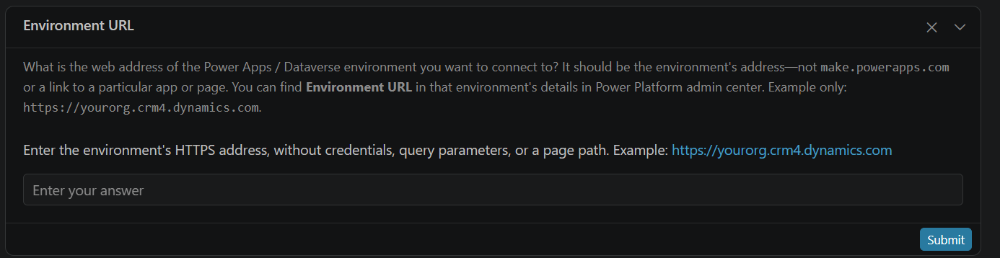

### Tenant ID

A **tenant** is your Microsoft organization/directory. In **Microsoft Entra
admin center**, select the directory that owns the environment, then open
**Entra ID > Overview > Properties > Tenant ID**.

This is **not** the PPAC Environment ID, Dataverse Organization ID, or an Azure
Subscription ID. A Subscription ID is not normally needed for this connection
flow. Ask your administrator if you cannot find the correct Tenant ID.

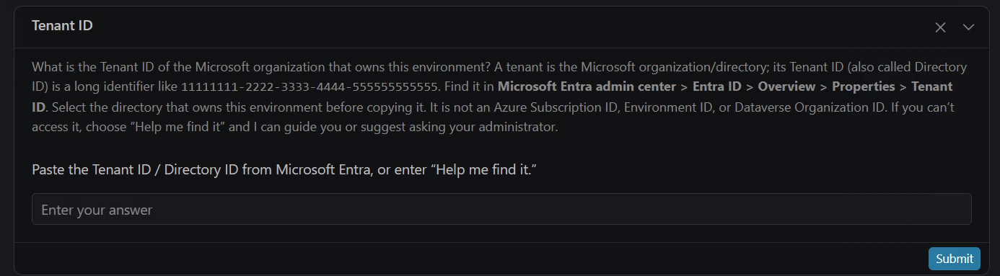

### Sign-in email

Supply your work or school **sign-in username**, also called a UPN. It is
usually your email address, but use the actual Microsoft sign-in name if
your mailbox address differs. **Never send a password, token, or MFA code
to the chat.**

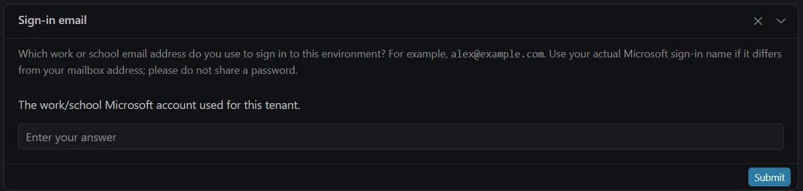

### Connection nickname

Choose a short local label such as **my-demo-environment**. This alias helps
the agent identify the saved connection; it does not create or rename an
environment. Use lowercase letters, digits, and hyphens, beginning with a
letter, with at most 30 characters. The run's actual names are redacted below.

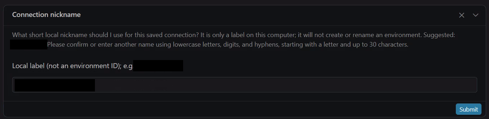

## 3. Choose only the tools you need

| Choice | Purpose |
|---|---|
| PAC CLI | Power Platform development and deployment commands. |
| Dataverse CLI | Dataverse commands and the MCP proxy. |
| Azure CLI | Azure-dependent workflows; installing it earlier did not sign you in. |
| Dataverse MCP | Dataverse tools available to the agent in chat. |
| Copilot Studio MCP | Separate Copilot Studio tools; not required just for Dataverse or Model Apps. |
| Python SDK | Optional programmatic access; not required just to sign these CLIs in. |

This run selected PAC CLI, Dataverse CLI, Azure CLI, and Dataverse MCP.
**You do not have to select the same set.** Azure sign-in is optional even
though Azure CLI is included in the default Windows prerequisite setup.

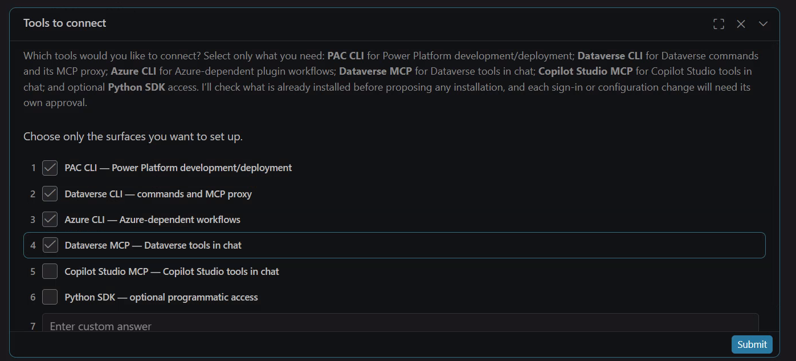

## 4. Approve an additional installation only if needed

The agent should check the local installation before proposing downloads.
These are three different components:

- **PAC CLI** is the `pac` tool installed by Setup.cmd.
- The **Dataverse plugin** supplies agent skills and tools.
- **Dataverse CLI** is the separate npm package `@microsoft/dataverse`, providing
  the `dataverse` command and the MCP proxy used by this connection flow.

In this run, the Dataverse CLI was missing. The agent explained the package,
the local install location, and the proposed command, then requested approval.
**Global npm installation means a command usable outside one project, not
access to every tenant.** It does not sign you in or register MCP.

If the package is already installed, reuse a compatible copy. A command missing
from an old app process's PATH is not by itself a reason to reinstall.

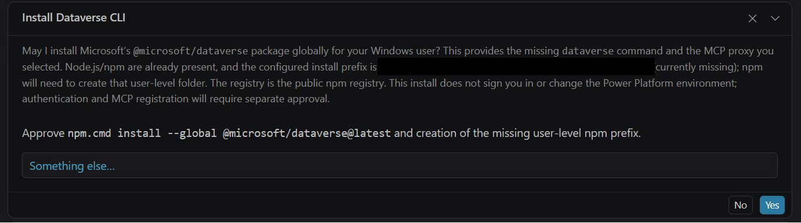

## 5. Approve the required sign-ins

Review the confirmed account, tenant, environment, and proposed profile names.
The agent should reuse matching working profiles and ask before creating or
switching profiles or starting authentication. Do not alter unrelated profiles.

Dataverse CLI and PAC can require **separate initial sign-ins**. Azure sign-in,
when selected, needs its own approval and the agreed isolated Azure
configuration directory. PAC/Dataverse profiles and Windows authentication
brokers are not isolated merely by using a different project folder.

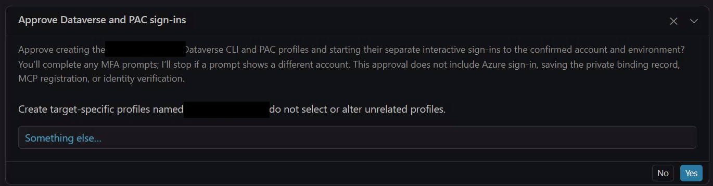

Complete Microsoft sign-in and MFA yourself in the approved browser/account
or Windows broker. Stop if it shows the wrong identity. Return to the agent
afterward; do not paste authentication codes, callback URLs, or page contents.
**The supplied authentication-complete browser screenshot is intentionally
not published.**

## 6. Approve bounded read-only verification

A successful sign-in page does not prove that the correct environment is
reachable. The agent asks separately to check the selected tools against the
confirmed identity and environment.

The shown plan limits checks to identity/organization metadata and, for the
selected Azure connection, token-expiry metadata without printing the token.
It does not authorize browsing customer records, changing permissions, or
writing cloud resources.

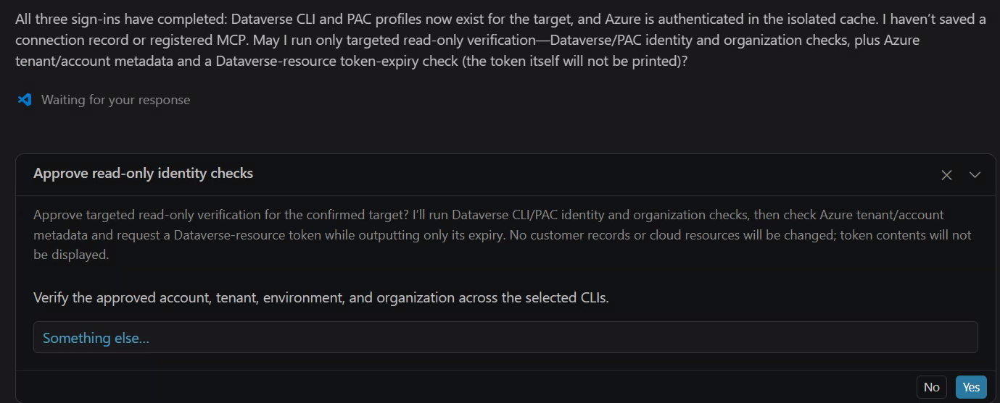

## 7. Save a private connection record, if approved

The skill can save a **private local binding record** so a later chat can find
the intended account, environment, profile names, and approved configuration
locations. It is not a password or token store. The official tools manage
their own protected credentials.

The agent must ask before saving this record, preserve unrelated connections,
and stop on a conflicting existing binding. Keep the record and local backups
outside public repositories; their metadata can still identify your organization.
Saving the record does **not** register an MCP server.

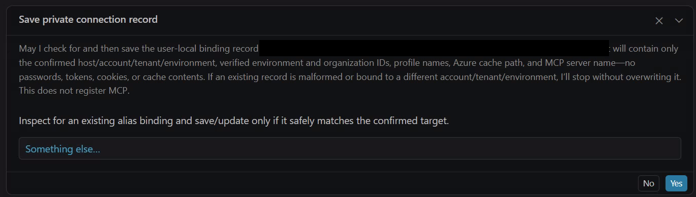

## 8. Approve Dataverse MCP registration separately

If selected, the agent proposes a named Dataverse MCP definition for the
confirmed environment, using the installed CLI's supported proxy mechanism.
Review the actual executable, target, configuration scope, and permissions
locally before approving. Preserve existing definitions and restrictions.

**Use the intended app and agent harness's documented MCP configuration.**
Do not assume that a Copilot desktop/CLI configuration file also configures
every VS Code session. See the [VS Code MCP documentation](https://code.visualstudio.com/docs/agent-customization/mcp-servers)
and ask the agent to stop if the correct host mechanism is uncertain.
The full host-specific proposal is hidden in this screenshot: it contains
private connection details and is not a configuration template to copy.

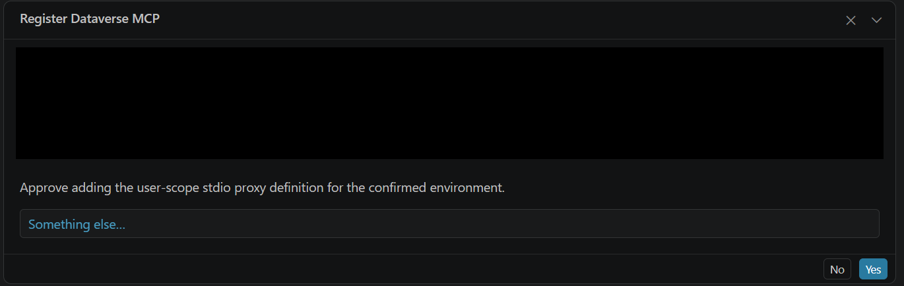

Registration saves a definition; it does not itself prove the server starts
or can access Dataverse. Launching the server and live verification require
their own approval. Missing tenant consent, allowlisting, or roles must be
reported for a separate decision, not silently changed.

## 9. Restart when required, then verify the live connection

The agent should explain any reload/restart needed to load the definition.
If restarting interrupts the current chat, save the handoff first and restart
the app yourself. It should not close the app without your agreement.

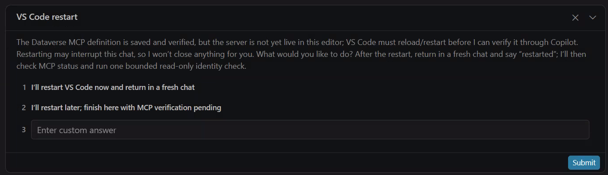

**Before restart:** the agent reports CLI checks and the saved definition,
but explicitly leaves live MCP verification pending. That is a partial
completion, not a fully verified MCP connection.

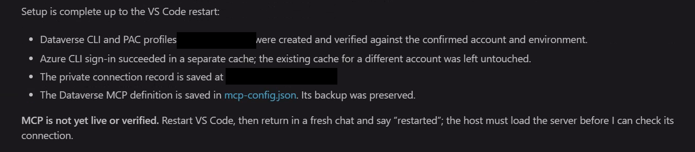

After restarting, open a fresh chat and identify the saved connection. For
example:

> I have restarted. Use my saved connection named my-demo-environment.
> Confirm the intended account and environment, then check whether the
> Dataverse MCP server is available. Ask before starting it or making a
> bounded read-only identity check. Reuse working sessions; do not change
> permissions or customer records.

Replace the fictional nickname with your own. The goal is to confirm both
that the host exposes the MCP server and that an actual MCP identity call
succeeds against the intended environment. A CLI-only fallback does not
prove that MCP works.

**After restart:** the supplied run's final message reports a successful
read-only MCP identity check matching the CLI-verified organization. The actual
organization ID and unrelated session information have been removed.

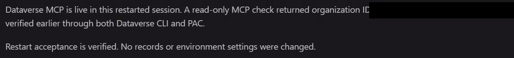

This is the outcome reported in that user's run; this documentation update
did not perform new sign-ins or replay live tenant checks. It does not prove
every operation is permitted, or guarantee that future sessions never need MFA
or renewal. Sandbox connections also disappear if that Sandbox is discarded.

## Before sharing your own screenshots

Remove real environment URLs, sign-in emails, directory/environment/organization
IDs, profile nicknames, identifying filenames/server names, and private paths.
Use permanent opaque redactions or crop them out, not a reversible overlay.
Never publish authentication pages, passwords, tokens, cookies, device codes,
callback URLs, or protected cache contents.

For the full approval boundaries and current instructions, read the
[connection skill](../skills/power-platform-connect/SKILL.md) and
[advanced setup guide](advanced-setup.md).
